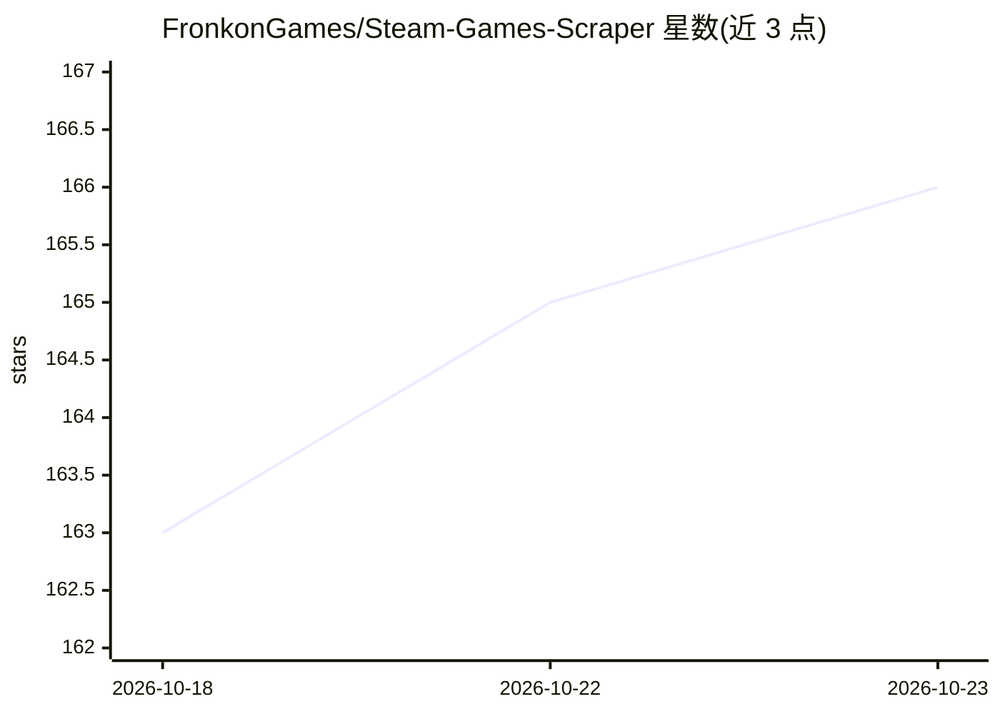

# FronkonGames/Steam-Games-Scraper

⭐ 166 · Python · MIT · 推送 2026-06-19 · [GitHub](https://github.com/FronkonGames/Steam-Games-Scraper) · [官网](https://fronkongames.github.io/) · 个人维护

**抓取 Steam 全部游戏信息并存为 JSON 的 Python 脚本**

通过 Steam Web API 抓取已发售游戏的名称、开发者、价格等数据，并补充 SteamSpy 的额外信息，以 JSON 格式存储；首次运行生成超过 14 万条 AppID 的 applist.json，后续运行增量更新。仅保存已发售且开发者字段非空的游戏，DLC、音乐、工具等被排除。需 Python 3.10+ 与 Steam API Key（.env 配置），默认按 1.5 秒间隔限速请求。作者用其生成 'Steam Games Dataset' 数据集。支持 uv 或 pip 安装运行，提供输入输出文件、货币、语言、自动保存等参数。

## 筛选速览

| 维度 | 判定 | 备注 |
|---|---|---|
| AI 角色 | `ai-knowledge` | 知识聚合/清单类 |
| 许可风险 | `permissive` | MIT |
| 部署形态 | `library` | 以包/库形式分发 |
| 模型依赖 | — | README 未给出锁定关系 |
| 硬件要求 | — | 无带数字的原话,不猜 |
| 安装摩擦 | `low` | 无编译、无系统依赖或容器化 |
| 成熟度 | — | 结构信号不足 |

## 能力要点

- 通过 Steam Web API 抓取全部已发售游戏数据并存为 JSON
- 合并 SteamSpy 额外数据（可关闭）
- applist.json 增量更新，未发售游戏单独记录不重复请求
- 支持货币/语言/限速/重试/自动保存等命令行参数

## 适用场景

- 构建 Steam 游戏数据集用于数据分析或机器学习
- 跟踪 Steam 新上架游戏的增量更新
- 按指定货币与语言批量获取游戏价格信息

## 场景标签

`网页抓取` · 领域:效率与自动化

## 证据(README 行号)

> L1: Extract information from all games published in Steam thanks to its Web API, and store it in JSON format. It also co
> L3: I used this code to generate these dataset: 'Steam Games Dataset'.

## 星数曲线

2026-10-18 163 → 2026-10-23 166（+3）

---
*卡片 v1 · prompt 1.4 · 生成 2026-10-22 · 置信度 low · 依据 README sha `6fe0b8f9efd9` · [字段定义](../../DATASET.md)*
