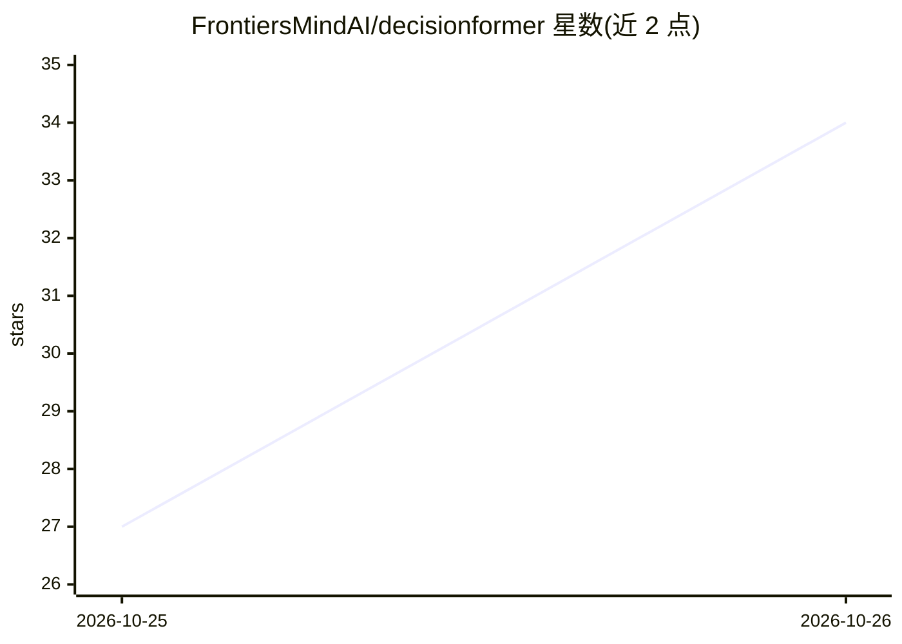

# FrontiersMindAI/decisionformer

⭐ 34 · Python · Apache-2.0 · 推送 2026-10-23 · [GitHub](https://github.com/FrontiersMindAI/decisionformer) · 组织维护

**在任意 Hugging Face 模型上微调与服务校准决策模型的库**

Python 库与 CLI：将 Hugging Face transformers 的各类骨干（解码器、MoE、混合线性注意力、编码器）转换为决策模型——输入 state 与类型化问题，单次前向返回各选项的校准概率，不生成文本。提供三行推理 API、一条命令微调（全量/LoRA/QLoRA，YAML 配方可覆盖）、一条命令起 FastAPI 服务（/v1/systemone，可选 vLLM 后端）。支持 CPU/MPS/CUDA 自动选设备，笔记本电脑可全量微调 135M 模型。限制：不支持 trust_remote_code 模型；超长请求拒绝而非截断；Qwen3.5 答案码微调尚不可靠。

## 筛选速览

| 维度 | 判定 | 备注 |
|---|---|---|
| AI 角色 | `ai-ecosystem` | LLM/agent 周边工具 |
| 许可风险 | `permissive` | Apache-2.0 |
| 部署形态 | `library` | 以包/库形式分发 |
| 模型依赖 | local-ok | 支持本地模型 |
| 硬件要求 | — | 无带数字的原话,不猜 |
| 安装摩擦 | `medium` | 含编译或系统依赖之一 |
| 成熟度 | — | 结构信号不足 |

## 能力要点

- 单次前向输出各选项校准概率，无文本生成
- 覆盖解码器/MoE/混合线性注意力/编码器多类骨干，含 6 种决策头
- pip 安装，CLI 一条命令微调与服务，YAML 配方全可覆盖
- 设备自动选择 CUDA/MPS/CPU，笔记本可全量微调小模型

## 适用场景

- 把现有 LLM 微调成给出校准概率的决策/分类模型
- 以 /v1/systemone API 部署决策模型供下游系统调用
- 在笔记本电脑上用 LoRA/QLoRA 小成本微调决策模型

## 场景标签

`微调` `推理引擎` · 领域:训练与推理

## 证据(README 行号)

> L5: The simplest way to fine-tune and serve decision models on any Hugging Face model. Give it a *state* and typed
> L64: decisionformer serve vllm-sr/d3-edge --port 8000
> L104: Backbones are the architectures built into Hugging Face transformers, loaded with its `Auto` classes and saved wit

## 星数曲线

2026-10-25 27 → 2026-10-26 34（+7）

---
*卡片 v1 · prompt 1.4 · 生成 2026-10-25 · 置信度 high · 依据 README sha `e5d977d9aeab` · [字段定义](../../DATASET.md)*
