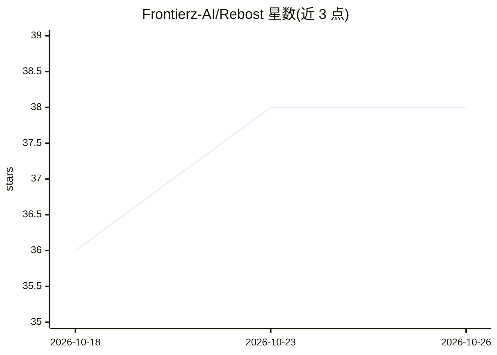

# Frontierz-AI/Rebost

⭐ 38 · Rust · MIT · 推送 2026-10-23 · [GitHub](https://github.com/Frontierz-AI/Rebost) · [官网](https://rebost.ai/) · 组织维护

**Mac/Windows 本地 AI 桌面应用：私有文档问答带引用**

基于 Tauri（Rust+Svelte）的桌面应用，在用户机器上运行本地 AI，通过 Shelf 关联文件夹后对文档提问；回答本地生成并附引用可回溯原文。首次启动按机器内存推荐并下载模型，模型常驻磁盘；支持图片问答、可复用提示（Recipe）与全局指令（House rules）。文档不上传，联网仅用于下载模型（Hugging Face/Ollama）与更新检查，网页查询默认关闭。Mac/Windows 提供安装包，不支持 Linux 与手机。

## 筛选速览

| 维度 | 判定 | 备注 |
|---|---|---|
| AI 角色 | `ai-native` | 本体是模型或模型工具 |
| 许可风险 | `permissive` | MIT |
| 部署形态 | `library` | 以包/库形式分发 |
| 模型依赖 | — | README 未给出锁定关系 |
| 硬件要求 | — | 无带数字的原话,不猜 |
| 安装摩擦 | `medium` | 含编译或系统依赖之一 |
| 成熟度 | — | 结构信号不足 |

## 能力要点

- 本地运行 AI 对 Shelf 文件夹文档做问答，回答附引用并可打开来源段落
- 首次启动按机器内存推荐模型并下载，本地生成回答，无需账号
- Recipe 保存复用提示，House rules 设置全局指令
- 文档不上传，联网仅限模型下载与更新检查

## 适用场景

- 在不上传文档的前提下对本机文件提问并获得带引用的回答
- 小团队各自安装并指向共享文件夹，无中间服务器
- 把每周重复的请求保存为 Recipe 反复使用

## 场景标签

`文档问答` · 领域:知识与检索

## 证据(README 行号)

> L7: Rebost is a desktop application for Mac and Windows. It runs an AI on the machine where it is installed and answers 
> L11: The first launch offers an AI sized for the machine's memory and downloads it. That file stays on disk, and every l

## 星数曲线

2026-10-18 36 → 2026-10-26 38（+2）

---
*卡片 v1 · prompt 1.4 · 生成 2026-10-25 · 置信度 high · 依据 README sha `5bc5b6ae7635` · [字段定义](../../DATASET.md)*
