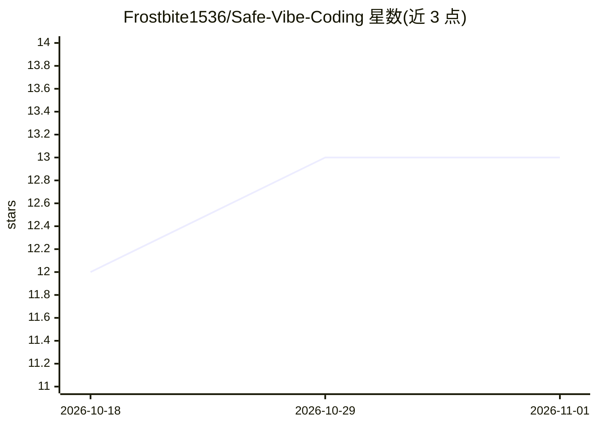

# Frostbite1536/Safe-Vibe-Coding

⭐ 13 · Ruby · NOASSERTION · 推送 2026-07-27 · [GitHub](https://github.com/Frostbite1536/Safe-Vibe-Coding) · [官网](https://frostbite1536.github.io/Safe-Vibe-Coding/) · 个人维护

**面向开发者的 LLM 编码实战指南：流程、原则与提示词模板**

一份关于使用 LLM 编码代理构建软件的实践指南文档，内容包括 13 条核心工作流原则（产品对话先行、系统不变量定义、持续测试、模块化约束、组件边界 bug 排查、检查点摘要等）、配套的 /prompts 目录（18 个覆盖从项目引导到代码审查、智能合约审计的即用模板），以及 Claude Code 设置、上下文管理、AI 代码审查、反模式识别等延伸阅读文档。面向使用 AI 辅助开发的软件工程师，形式为文档仓库，无需安装运行。

## 筛选速览

| 维度 | 判定 | 备注 |
|---|---|---|
| AI 角色 | `ai-knowledge` | 知识聚合/清单类 |
| 许可风险 | `none` | NOASSERTION |
| 部署形态 | `None` |  |
| 模型依赖 | — | README 未给出锁定关系 |
| 硬件要求 | — | 无带数字的原话,不猜 |
| 安装摩擦 | `low` | 无编译、无系统依赖或容器化 |
| 成熟度 | — | 结构信号不足 |

## 能力要点

- 13 条 LLM 协作工作流原则（不变量、测试门禁、模块化等）
- 18 个覆盖完整工作流的即用提示词模板
- 含 Claude Code 设置、上下文管理、AI 代码审查等配套指南

## 适用场景

- 学习如何以结构化流程指挥 LLM 编码代理开发软件
- 复用现成提示词模板做代码审查、bug 排查与项目引导
- 为团队建立 AI 辅助开发的规范与检查点制度

## 场景标签

`提示工程` `教程课程` · 领域:Agent 开发

## 证据(README 行号)

> L1: # Vibe Coding with LLMs: A Practical Guide to Building Real Software
> L3: This guide describes a collaborative, structured way to build software with LLMs while maintaining correctness, stab
> L5: > **📋 Just want the prompts?** → **`prompts/`** — 18 ready-to-use templates covering the whole workflow:

## 星数曲线

2026-10-18 12 → 2026-11-01 13（+1）

---
*卡片 v1 · prompt 1.4 · 生成 2026-11-01 · 置信度 high · 依据 README sha `9834630e9618` · [字段定义](../../DATASET.md)*
