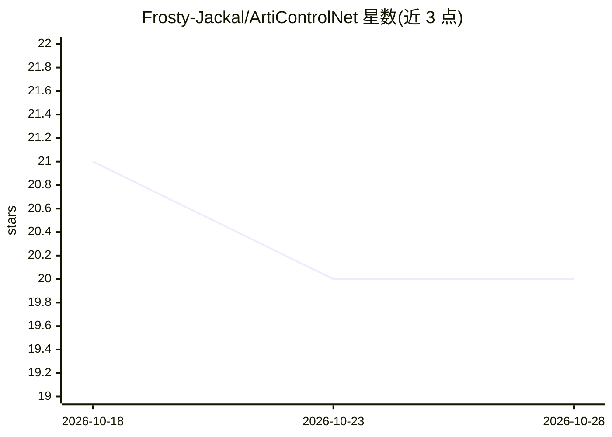

# Frosty-Jackal/ArtiControlNet

⭐ 20 · Python · MIT · 推送 2026-10-13 · [GitHub](https://github.com/Frosty-Jackal/ArtiControlNet) · 组织维护 · 中文 README

**面向设计场景的 AIGC 系统：文生图、线稿上色、图像问答**

自托管的 AI 辅助设计 Web 系统：提供文生图、线稿生图（指定颜色与风格）、图像问答（评图/打分/分析）功能，并基于用户上传与生成的作品建立个人「风格档案」。所有模型推理走云端模型 API（密钥配置于 .env），本地无需显卡。架构为 Vue 3 SPA + FastAPI 编排层 + SQLite，由单个 uvicorn 进程同时提供前端页面与后端接口；Windows 提供一键启动脚本，另覆盖云服务器部署与 cloudflared 隧道公开访问方案。有免费额度与充值机制，试用需邮件联系管理员开通账号。

## 筛选速览

| 维度 | 判定 | 备注 |
|---|---|---|
| AI 角色 | `ai-native` | 本体是模型或模型工具 |
| 许可风险 | `permissive` | MIT |
| 部署形态 | `desktop` | 安装包/桌面程序 |
| 模型依赖 | — | README 未给出锁定关系 |
| 硬件要求 | — | 无带数字的原话,不猜 |
| 安装摩擦 | `low` | 无编译、无系统依赖或容器化 |
| 成熟度 | — | 结构信号不足 |

## 能力要点

- 文生图、线稿生图、图像问答三类核心功能
- 基于用户作品自动生成个人风格档案
- 推理全部走云端模型 API，本地无需显卡
- 单进程 FastAPI 同时托管前端与后端，附 Windows 一键启动脚本

## 适用场景

- 设计专业的学生在电脑上做线稿上色与绘画参考
- 不会画画的用户用自然语言描述生成设计图
- 上传作品让系统评图、打分或分析

## 场景标签

`图像生成` `多模态` · 领域:内容生成

## 证据(README 行号)

> L35: |文生图|线稿生图|图像问答|
> L37: |**文生图** 描述你想要的画面，它生成一张新图|**线稿生图** 手绘线稿传上来，指定颜色与风格，成品出来|**图像问答** 传图问它，评图、打分、逐像素分析都行|
> L91: ArtiControlNet 架构：Vue 3 SPA → FastAPI 编排层 → 云端模型 API

## 星数曲线

2026-10-18 21 → 2026-10-28 20（-1）

---
*卡片 v1 · prompt 1.4 · 生成 2026-10-28 · 置信度 high · 依据 README sha `5cbc6605964e` · [字段定义](../../DATASET.md)*
