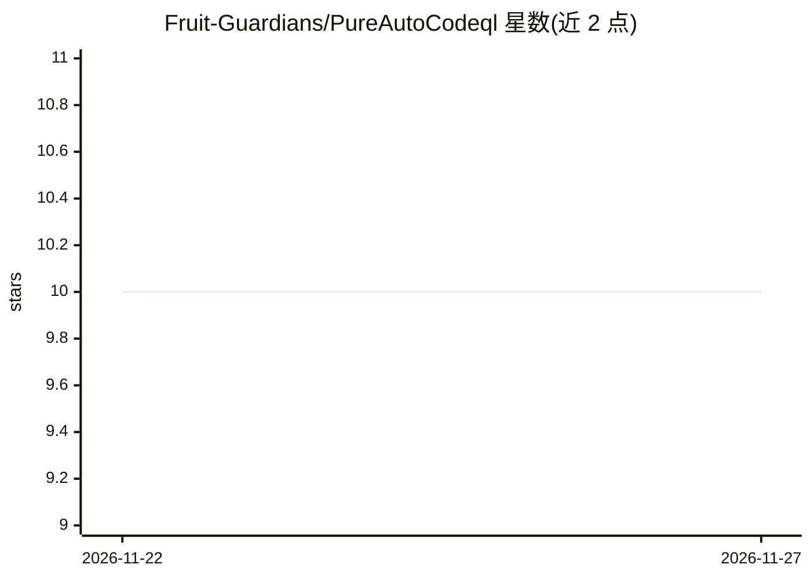

# Fruit-Guardians/PureAutoCodeql

⭐ 10 · Python · MIT · 推送 2026-09-26 · [GitHub](https://github.com/Fruit-Guardians/PureAutoCodeql) · [官网](https://github.com/Fruit-Guardians/PureAutoCodeql#readme) · 组织维护 · 中文 README

**面向 CVE 复盘与源码审计的多智能体 CodeQL 自动化流水线**

将 CVE 复盘流程组织为五阶段流水线：汇总漏洞情报与补丁、Sink/Source 双 Agent 定位危险点与用户可控输入、经语言知识库与模板生成 CodeQL Path Query 并用 LSP 校验迭代修复、对断流路径补 isAdditionalFlowStep 后重跑、最后以硬过滤加特征打分加 LLM 只读解释收敛路径。输出 SARIF、QL、精选路径与 manifest.json 运行清单；提供 CLI 与分离的 API/Worker 服务（PostgreSQL + Redis Streams）。需 Python 3.13+、uv、CodeQL CLI 与 Node.js 18+。

## 筛选速览

| 维度 | 判定 | 备注 |
|---|---|---|
| AI 角色 | `ai-native` | 本体是模型或模型工具 |
| 许可风险 | `permissive` | MIT |
| 部署形态 | `self-host` | docker 或自建部署 |
| 模型依赖 | locked-api |  |
| 硬件要求 | — | 无带数字的原话,不猜 |
| 安装摩擦 | `low` | 无编译、无系统依赖或容器化 |
| 成熟度 | — | 结构信号不足 |

## 能力要点

- Sink/Source 多 Agent 协作定位危险调用与用户可控输入
- CodeQL 查询生成 + LSP 校验闭环，断流点分析自动补 isAdditionalFlowStep
- 输出可复核的 SARIF、QL、精选路径与 manifest.json 运行清单
- 内置 deepseek/siliconflow/zhipu/kimi/gemini 配置，支持任意 OpenAI 兼容服务商

## 适用场景

- 复盘某个 CVE，自动生成可维护的 CodeQL 查询
- 对导入的第三方项目做源/汇路径分析
- 沉淀 CodeQL 规则与保留结构化证据的源码审计
- 通过 API 服务把分析流水线接入平台或前端

## 场景标签

`多智能体` `网络安全` · 领域:Agent 开发

## 证据(README 行号)

> L12: **面向 CVE 复盘与源码审计的多智能体 CodeQL 自动化系统**
> L69: 多 Agent（LangChain / LangGraph）协作：源码侧经 MCP（文件系统、ripgrep）与语言服务器按需取上下文；CodeQL 侧用内部知识库约束生成，并用 CodeQL LSP 做语法闭环。支持 DeepS
> L106: 内置：`deepseek` · `siliconflow` · `zhipu` · `kimi` · `gemini`

## 星数曲线

2026-11-22 10 → 2026-11-27 10（+0）

---
*卡片 v1 · prompt 1.4 · 生成 2026-11-22 · 置信度 high · 依据 README sha `b68f62625360` · [字段定义](../../DATASET.md)*
