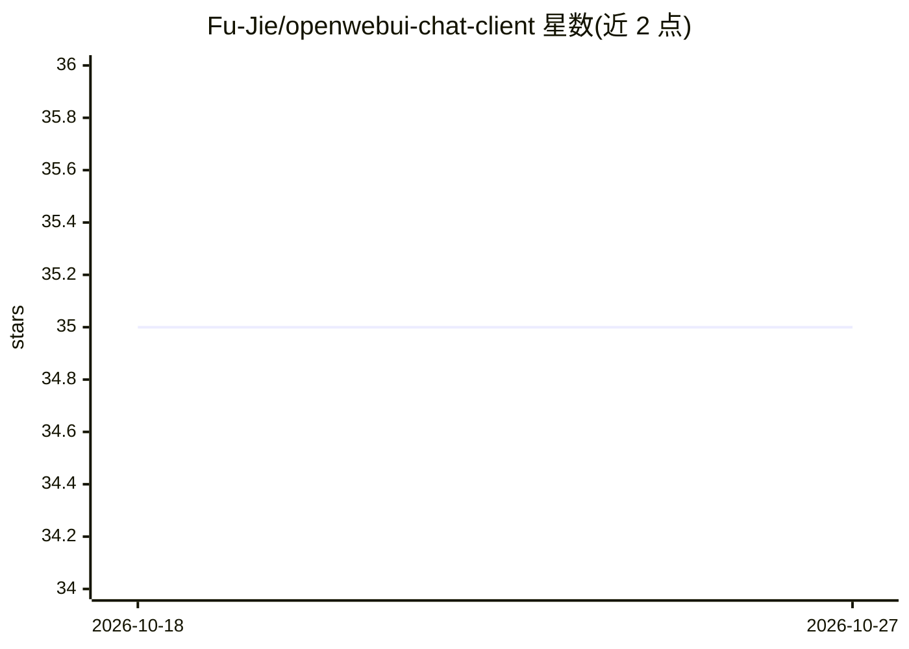

# Fu-Jie/openwebui-chat-client

⭐ 35 · Python · GPL-3.0 · 推送 2026-03-02 · [GitHub](https://github.com/Fu-Jie/openwebui-chat-client) · [官网](https://fu-jie.github.io/openwebui-chat-client/) · 个人维护 · 中文 README

**面向 Open WebUI API 的有状态 Python 客户端库**

openwebui-chat-client 是对接 Open WebUI API 的 Python 客户端库，面向需要通过代码访问 Open WebUI 实例的开发者。提供同步与异步客户端，支持单模型/并行多模型对话、流式输出、工具调用、文件上传、RAG 与知识库管理、自主多步任务处理（process_task，含 Key Findings 积累、待办列表与可选决策模型）、深度研究代理，以及模型/用户/Prompts/Notes/聊天归档等管理操作。需连接已有 Open WebUI 实例并提供 API Key，项目处于活跃开发期，API 可能变更。

## 筛选速览

| 维度 | 判定 | 备注 |
|---|---|---|
| AI 角色 | `ai-ecosystem` | LLM/agent 周边工具 |
| 许可风险 | `viral` | GPL-3.0 |
| 部署形态 | `library` | 以包/库形式分发 |
| 模型依赖 | — | README 未给出锁定关系 |
| 硬件要求 | — | 无带数字的原话,不猜 |
| 安装摩擦 | `low` | 无编译、无系统依赖或容器化 |
| 成熟度 | `idea` | |

## 能力要点

- 同步 AsyncOpenWebUIClient 双客户端，支持流式输出与并行多模型查询
- process_task/stream_process_task 多步迭代任务处理，集成工具服务器与知识库
- 知识库管理与 RAG 检索增强对话
- 聊天、模型、用户、Prompts、Notes 的编程化管理

## 适用场景

- 在 Python 应用中调用 Open WebUI 的模型对话与 RAG 能力
- 自动化管理和归档 Open WebUI 中的大量聊天会话
- 构建多步自主任务处理与研究代理流程

## 场景标签

 · 领域:LLM 基础设施/API 客户端

## 证据(README 行号)

> L12: **openwebui-chat-client** is a comprehensive, stateful Python client library for the Open WebUI API. It enables int
> L47: - **Autonomous Task Processing**: Multi-step iterative problem-solving with `process_task` and `stream_process_task

## 星数曲线

2026-10-18 35 → 2026-10-27 35（+0）

---
*卡片 v1 · prompt 1.4 · 生成 2026-10-25 · 置信度 high · 依据 README sha `01c6a2090d6b` · [字段定义](../../DATASET.md)*
