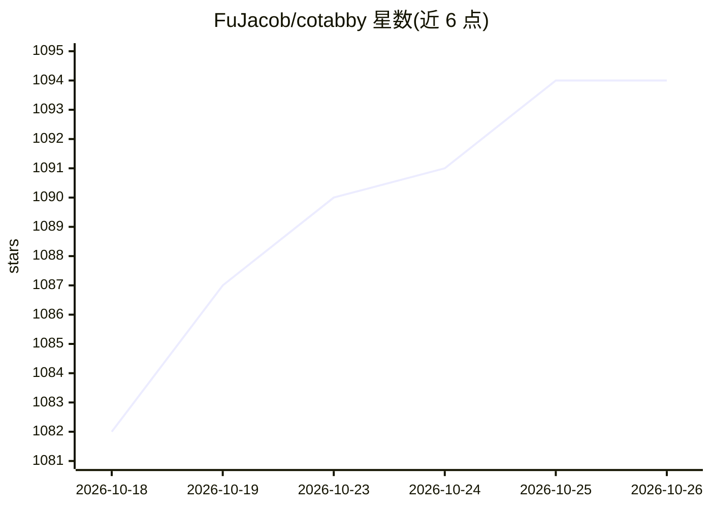

# FuJacob/cotabby

⭐ 1,094 · Swift · AGPL-3.0 · 推送 2026-10-15 · [GitHub](https://github.com/FuJacob/cotabby) · [官网](https://cotabby.app) · 个人维护

**macOS 全局本地 AI 自动补全工具，任意文本框内联建议**

面向 Mac 用户的本地优先 AI 补全应用：在几乎所有 macOS 文本框中显示灰色内联建议，Tab 逐词接受。提供三种引擎：Apple Intelligence（需 macOS 26）、通过 llama.cpp 进程内运行 GGUF 基座模型的开源引擎（内置 tabby-2 系列 0.8–5.0 GB 模型，可自带 GGUF）、以及可选的 OpenAI 兼容端点（可接本地 Ollama 或自建服务器）。无遥测与账号，默认不落盘记录输入；需 macOS 14+，通过 Homebrew cask 或 DMG 安装，需授予辅助功能等权限。目前标注 beta，由两名学生维护。

## 筛选速览

| 维度 | 判定 | 备注 |
|---|---|---|
| AI 角色 | `ai-native` | 本体是模型或模型工具 |
| 许可风险 | `viral` | AGPL-3.0 |
| 部署形态 | `desktop` | 安装包/桌面程序 |
| 模型依赖 | local-ok | 支持本地模型 |
| 硬件要求 | — | 无带数字的原话,不猜 |
| 安装摩擦 | `low` | 无编译、无系统依赖或容器化 |
| 成熟度 | `idea` | |

## 能力要点

- Apple Intelligence / 本地 GGUF（llama.cpp 进程内）/ OpenAI 兼容端点三种引擎可选
- 内置 tabby-2 系列 GGUF 模型（0.8–5.0 GB）并可自带任意 GGUF 模型
- 除补全外提供 emoji 补全、斜杠内联宏（换算/日期/随机值）、一键纠错
- 无账号、无遥测、无崩溃上报，密码等安全字段中阻断生成

## 适用场景

- 在 Mac 上任何应用里获得逐词 AI 补全而不联网上传输入
- 用本地 Ollama 或自建端点作为补全后端
- 为低内存旧款 Mac 选择小模型离线补全

## 场景标签

`AI 写作` · 领域:内容生成

## 证据(README 行号)

> L31: Cotabby adds AI autocomplete to almost any text field on your Mac. As you type, a gray suggestion appears inline ne
> L58: - Apple Intelligence and Open Source generation run on-device.
> L72: - **OpenAI-compatible** — a completion or chat endpoint you configure, including local Ollama,

## 星数曲线

2026-10-18 1,082 → 2026-10-26 1,094（+12）

---
*卡片 v1 · prompt 1.4 · 生成 2026-10-21 · 置信度 high · 依据 README sha `117516d3df66` · [字段定义](../../DATASET.md)*
