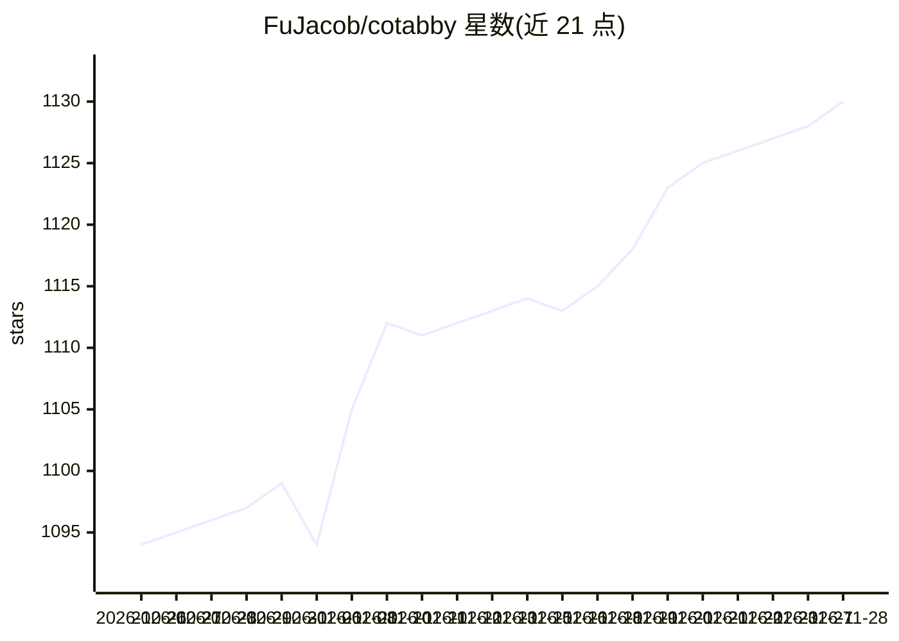

# FuJacob/cotabby

⭐ 1,130 · Swift · AGPL-3.0 · 推送 2026-11-23 · [GitHub](https://github.com/FuJacob/cotabby) · [官网](https://cotabby.app) · 组织维护

**macOS 全系统任意输入框的本地 AI 自动补全工具**

面向 macOS 用户的系统级 AI 补全工具：在几乎所有文本输入框中即时给出灰色 ghost-text 建议，按 Tab 逐词接受，另提供 Emoji 补全、内联宏（数学/单位/汇率/日期）、一键纠错与快捷键自定义。三引擎可选：Apple Intelligence（需 macOS 26+ 支持机型）、内置开源引擎（经 llama.cpp 在进程内运行 GGUF 基座模型，支持自带模型）、以及可自配的 OpenAI 兼容端点。无账号与遥测；AGPL v3 许可，由两名学生维护，处于 beta 阶段。

## 筛选速览

| 维度 | 判定 | 备注 |
|---|---|---|
| AI 角色 | `ai-native` | 本体是模型或模型工具 |
| 许可风险 | `viral` | AGPL-3.0 |
| 部署形态 | `desktop` | 安装包/桌面程序 |
| 模型依赖 | local-ok | 支持本地模型 |
| 硬件要求 | — | 无带数字的原话,不猜 |
| 安装摩擦 | `low` | 无编译、无系统依赖或容器化 |
| 成熟度 | `idea` | |

## 能力要点

- 系统级 ghost-text 补全，Tab 逐词接受，快捷键可重绑定
- 内置引擎经 llama.cpp 进程内运行 GGUF 基座模型，支持放入任意 .gguf 自带模型
- 提供四档内置模型（0.8GB–5GB）从菜单栏直接下载
- Emoji 补全、内联宏、一键纠错；无遥测无账号

## 适用场景

- 在任意 macOS 应用中打字时获得本地自动补全建议
- 注重隐私、希望文本不出本机的写作者
- 通过自配 OpenAI 兼容端点（含本地 Ollama）使用自有模型

## 场景标签

`代码生成` `AI 写作` `推理引擎` · 领域:编码与开发

## 证据(README 行号)

> L31: Cotabby adds AI autocomplete to almost any text field on your Mac. As you type, a gray suggestion appears inline ne
> L88: Under the hood, the Open Source engine runs local GGUF *base* models in-process through llama.cpp (via CotabbyInfer
> L103: **Compatibility:** macOS 14.0 or later. The Apple Intelligence engine needs macOS 26 or later on a supported Mac; 

## 星数曲线

2026-10-26 1,094 → 2026-11-28 1,130（+36）

---
*卡片 v1 · prompt 1.4 · 生成 2026-11-25 · 置信度 high · 依据 README sha `3e93b26ed96e` · [字段定义](../../DATASET.md)*
