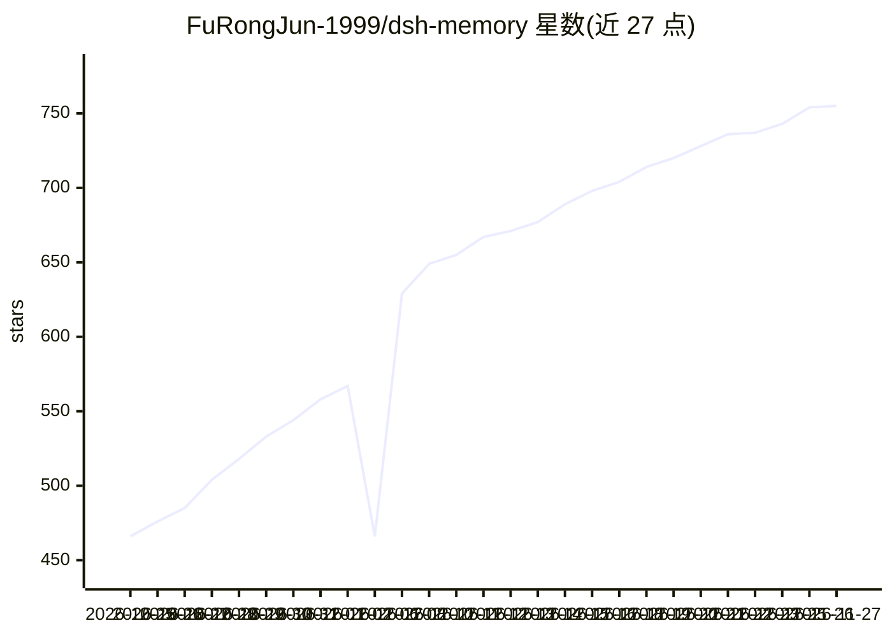

# FuRongJun-1999/dsh-memory

⭐ 755 · Python · MIT · 推送 2026-11-26 · [GitHub](https://github.com/FuRongJun-1999/dsh-memory) · 个人维护 · 中文 README

**给 AI Agent 挂载可审计长期记忆的 MCP 记忆基础设施**

灵枢（LINGSHU）是一套长期记忆基础设施：对话沉淀为纯文本 md 认知图，写入按层级设复核闸门（contextual 直写、knowledge 需反思、structural 需验证、self/anchor 需人工），记什么、取什么、能否写入由确定性规则裁决，不依赖 LLM 判断，自称无幻觉、可审计、结果可复现。以 stdio MCP server 形式运行，任何支持 MCP 的 Agent 宿主可挂载；含 Rust 检索内核、多智能体并发与权限三层（读/写/裁）。需自行接入 Agent，完整评测需 Rust 工具链与 Node。

## 筛选速览

| 维度 | 判定 | 备注 |
|---|---|---|
| AI 角色 | `ai-ecosystem` | LLM/agent 周边工具 |
| 许可风险 | `permissive` | MIT |
| 部署形态 | `library` | 以包/库形式分发 |
| 模型依赖 | locked-api |  |
| 硬件要求 | — | 无带数字的原话,不猜 |
| 安装摩擦 | `low` | 无编译、无系统依赖或容器化 |
| 成熟度 | — | 结构信号不足 |

## 能力要点

- 写入按层复核闸门（MDCG_WRITE_GATE 三态）与只读 guest 默认权限
- 零 LLM 确定性规则裁决，写入以 committed 确认
- stdio MCP server，README 列出 DSH/CodeBuddy/ZCode/Codex CLI/Claude Code 五端接入目录
- Rust 检索内核 --serve 进程实例支撑多智能体并发

## 适用场景

- 给 MCP Agent 加跨会话长期记忆与审计留痕
- 多智能体共享同一份记忆库并发读写
- 按层控制记忆写入的复核与人工裁定流程

## 场景标签

`Agent 记忆` `知识图谱` `多智能体` · 领域:Agent 开发

## 证据(README 行号)

> L20: **灵枢是一套可运行的长期记忆基础设施**——对话自动沉淀为纯文本 md 认知图，记什么、取什么、能不能写入全部由确定性规则裁决，全程可审计、结果可复现。它不训练模型，做的是**模型之外的那一整套**：记忆怎么存、取的时候依据什么
> L125: - **🔌 多智能体适用**——同一份大脑 + 同一份纪律，接入 DSH · CodeBuddy · ZCode · Codex CLI · Claude Code，任何 MCP 宿主可直接挂载

## 星数曲线

2026-10-25 466 → 2026-11-27 755（+289）

---
*卡片 v1 · prompt 1.4 · 生成 2026-11-25 · 置信度 low · 依据 README sha `3b98bb88d444` · [字段定义](../../DATASET.md)*
