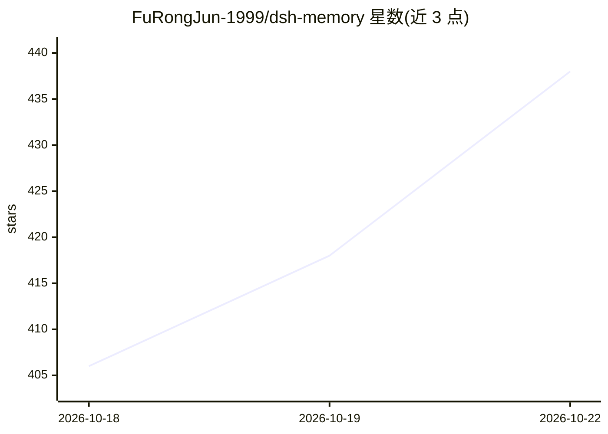

# FuRongJun-1999/dsh-memory

⭐ 453 · Python · MIT · 推送 2026-10-22 · [GitHub](https://github.com/FuRongJun-1999/dsh-memory) · 个人维护 · 中文 README

**面向 AI Agent 的长期记忆基础设施：确定性规则裁决的 md 认知图**

以纯文本 markdown 认知图为唯一真源的长期记忆系统：对话自动沉淀为记忆节点，写入过三道闸门、检索按确定性规则裁决（零 LLM 判断），遗忘须显式发起，全程可审计可复现。以 stdio MCP server 形式提供，DSH、CodeBuddy、ZCode、Codex CLI、Claude Code 等 MCP 宿主可挂载；另含 Rust 检索内核、蜂群运行时、中文编译器、蜂巢并发引擎四层独立组件。不训练模型、不发布权重，需接入用户自己的 Agent；完整评测需 Rust 工具链与 Node，跑全量套件要编译。默认以只读 guest 运行。

## 筛选速览

| 维度 | 判定 | 备注 |
|---|---|---|
| AI 角色 | `ai-ecosystem` | LLM/agent 周边工具 |
| 许可风险 | `permissive` | MIT |
| 部署形态 | `library` | 以包/库形式分发 |
| 模型依赖 | — | README 未给出锁定关系 |
| 硬件要求 | — | 无带数字的原话,不猜 |
| 安装摩擦 | `low` | 无编译、无系统依赖或容器化 |
| 成熟度 | `idea` | |

## 能力要点

- 对话自动沉淀为纯 md 认知图，原文即真源，索引为派生物
- 写入/检索/遗忘全由确定性规则裁决，零 LLM 判断，结果可复现
- 标准 stdio MCP server，DSH·CodeBuddy·ZCode·Codex CLI·Claude Code 均可挂载，--serve 支持多智能体并发
- 同仓库五件套：大脑/Rust 检索引擎/蜂群运行时/中文编译器/蜂巢并发引擎，各层独立可用

## 适用场景

- 让我的 AI Agent 跨会话保留可审计的长期记忆
- 多个智能体共享同一份记忆大脑并发访问
- 需要记忆写入/检索全过程留痕与可复现验证的场景

## 场景标签

`Agent 记忆` `多智能体` `知识图谱` · 领域:Agent 开发

## 证据(README 行号)

> L15: **灵枢是一套可运行的长期记忆基础设施**——对话自动沉淀为纯文本 md 认知图，记什么、取什么、能不能写入全部由确定性规则裁决，全程可审计、结果可复现。它不训练模型，做的是**模型之外的那一整套**：记忆怎么存、取的时候依据什么
> L43: |∞ **连接**|同一份大脑连所有智能体|标准 stdio MCP server——DSH · CodeBuddy · ZCode · Codex CLI · Claude Code 均可挂载；`--serve` 并发共享|
> L113: > **主推路径：MCP 直挂**——各端共性都是挂载同一个 stdio MCP server（`python -m md_cg.mcp_server`），**不依赖任何插件系统**。

## 星数曲线

2026-10-18 406 → 2026-10-22 438（+32）

---
*卡片 v1 · prompt 1.4 · 生成 2026-10-21 · 置信度 mid · 依据 README sha `0d6831104169` · [字段定义](../../DATASET.md)*
