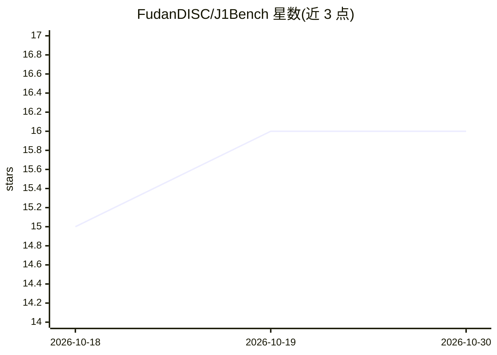

# FudanDISC/J1Bench

⭐ 16 · Python · 推送 2026-04-07 · [GitHub](https://github.com/FudanDISC/J1Bench) · [官网](https://j1bench.github.io/) · 组织维护 · 中文 README

**法律 LLM 智能体交互式评测基准（环境+数据+评测）**

面向法律智能的语言智能体评测基准：提供 J1-Envs 交互式法律环境，让 LLM 智能体在多种法律场景中按程序规则与各参与方交互完成任务；J1-Eval 数据集与评测流程对智能体表现打分并输出排名。运行前需在配置文件中填入模型 API key（OpenAI 或 vllm serve），通过 pip 安装依赖并用 bash 脚本启动环境与评测。论文被 ACL 2026 主会接收，由复旦大学团队维护。

## 筛选速览

| 维度 | 判定 | 备注 |
|---|---|---|
| AI 角色 | `ai-ecosystem` | LLM/agent 周边工具 |
| 许可风险 | `none` | — |
| 部署形态 | `library` | 以包/库形式分发 |
| 模型依赖 | local-ok | 支持本地模型 |
| 硬件要求 | — | 无带数字的原话,不猜 |
| 安装摩擦 | `low` | 无编译、无系统依赖或容器化 |
| 成熟度 | — | 结构信号不足 |

## 能力要点

- J1-Envs：LLM 智能体在程序规则下与多方交互的法律环境
- J1-Eval 数据集覆盖六个法律属性环境
- J1-Eval 评测脚本输出总分与详细结果
- 论文获 ACL 2026 主会接收

## 适用场景

- 评测法律场景下 LLM 智能体的任务完成能力
- 比较不同模型规模的智能体法律表现
- 为法律 AI 研究提供交互式环境与数据集

## 场景标签

`模型评测` · 领域:评测与运维

## 证据(README 行号)

> L10: J1-Bench is an **interactive and comprehensive legal benchmark** where LLM agents engage in diverse legal scenarios
> L18: - J1-Eval: Holistic Legal Agent Evaluation

## 星数曲线

2026-10-18 15 → 2026-10-30 16（+1）

---
*卡片 v1 · prompt 1.4 · 生成 2026-10-30 · 置信度 high · 依据 README sha `fd78b6e8c502` · [字段定义](../../DATASET.md)*
