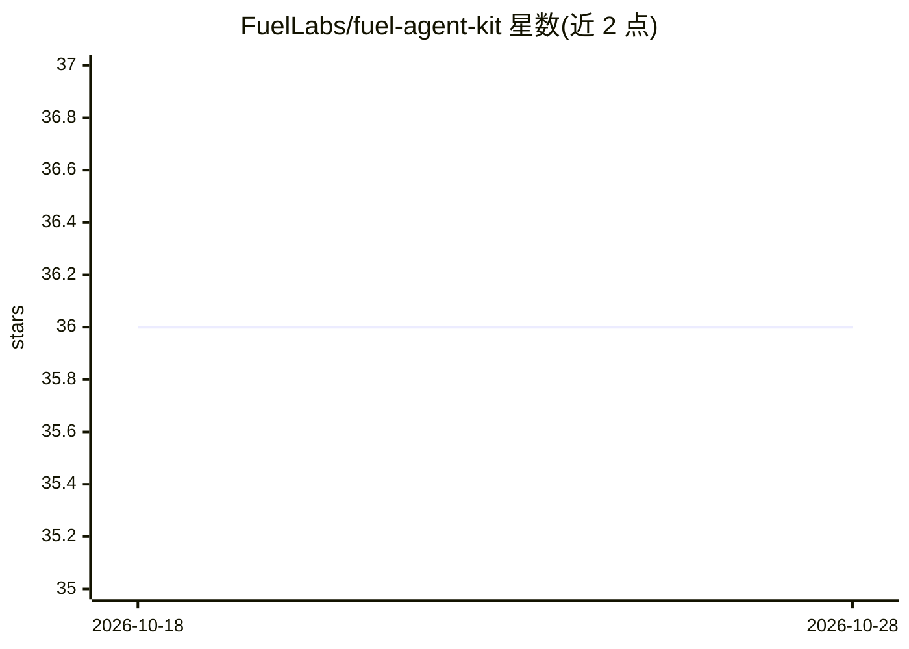

# FuelLabs/fuel-agent-kit

⭐ 36 · TypeScript · MIT · 推送 2026-02-11 · [GitHub](https://github.com/FuelLabs/fuel-agent-kit) · [官网](https://dhaiwatpandya.gitbook.io/fuel-agent-kit/) · 组织维护

**为开发者在 Fuel 区块链上构建 AI agent 的 TypeScript 工具包**

FuelLabs 维护的 alpha 阶段 npm 库，提供 FuelAgent 类与 transferTool 等工具，用于在 Fuel（Ethereum 生态 L2）链上构建可执行链上操作的 AI agent。支持 OpenAI、Gemini、Anthropic 的 API key 作为模型后端，LangChain 的工具可直接导入使用；使用时需提供 Fuel 钱包私钥与模型 API key。提供本地开发流程（npm install / npm run build）与测试目录说明。

## 筛选速览

| 维度 | 判定 | 备注 |
|---|---|---|
| AI 角色 | `ai-ecosystem` | LLM/agent 周边工具 |
| 许可风险 | `permissive` | MIT |
| 部署形态 | `library` | 以包/库形式分发 |
| 模型依赖 | — | README 未给出锁定关系 |
| 硬件要求 | — | 无带数字的原话,不猜 |
| 安装摩擦 | `low` | 无编译、无系统依赖或容器化 |
| 成熟度 | `idea` | |

## 能力要点

- FuelAgent 类封装链上 AI agent 的创建
- 支持 OpenAI / Gemini / Anthropic API key
- 内置 transferTool 等链上操作工具
- LangChain 工具可直接导入使用

## 适用场景

- 构建能执行 Fuel 链上转账等操作的 AI agent
- 在现有 LangChain 工具链中集成 Fuel 链上能力
- Web3 应用中接入 LLM 驱动的链上自动化

## 场景标签

`Agent 框架` · 领域:Agent 开发

## 证据(README 行号)

> L8: npm install fuel-agent-kit fuels@0.96.1
> L19: const agent = new FuelAgent({
> L23: All Langchain tools are also available to be imported and used directly.

## 星数曲线

2026-10-18 36 → 2026-10-28 36（+0）

---
*卡片 v1 · prompt 1.4 · 生成 2026-10-25 · 置信度 high · 依据 README sha `b1232a634d4b` · [字段定义](../../DATASET.md)*
