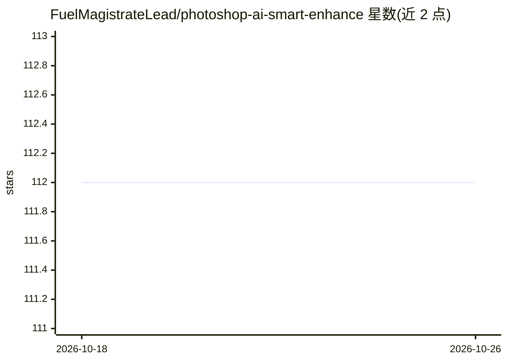

# FuelMagistrateLead/photoshop-ai-smart-enhance

⭐ 112 · HTML · 推送 2026-10-25 · [GitHub](https://github.com/FuelMagistrateLead/photoshop-ai-smart-enhance) · 个人维护

**Photoshop CC 2024+ 的机器学习图像增强扩展插件**

Adobe Photoshop 的 UXP 原生扩展（CC 2024+），用机器学习算法自动完成曝光校正、对比度与色彩自适应调整、锐化与降噪，支持实时预览、批量处理与智能对象非破坏性编辑。提供 7 种增强模式（人像/风景/产品/文档等）和 7 个预设配置。默认本地处理、不上传图像。面向摄影师、设计师与生产团队；需 Photoshop CC 2024+ 宿主，Windows/macOS 均可，GPU 为可选。

## 筛选速览

| 维度 | 判定 | 备注 |
|---|---|---|
| AI 角色 | `ai-native` | 本体是模型或模型工具 |
| 许可风险 | `none` | — |
| 部署形态 | `library` | 以包/库形式分发 |
| 模型依赖 | — | README 未给出锁定关系 |
| 硬件要求 | — | 无带数字的原话,不猜 |
| 安装摩擦 | `low` | 无编译、无系统依赖或容器化 |
| 成熟度 | — | 结构信号不足 |

## 能力要点

- 自适应曝光/对比度/色彩/降噪的自动图像增强
- 实时预览与批量处理（可并行）
- 7 种模式：人像、风景、产品、文档、极简等
- 本地处理、非破坏性智能对象编辑

## 适用场景

- 摄影师在 Photoshop 中一键修正曝光与色彩问题
- 按人像/产品/文档等场景选择针对性增强配置
- 批量处理整个文件夹的图像并输出结果

## 场景标签

`图像视频处理` · 领域:感知与多模态

## 证据(README 行号)

> L7: photoshop-ai-smart-enhance is a machine learning extension that automates image quality improvements. Smart exposure
> L22: photoshop-ai-smart-enhance analyzes image characteristics and applies intelligent adjustments. Automatically detect

## 星数曲线

2026-10-18 112 → 2026-10-26 112（+0）

---
*卡片 v1 · prompt 1.4 · 生成 2026-10-23 · 置信度 mid · 依据 README sha `1c44e2715949` · [字段定义](../../DATASET.md)*
