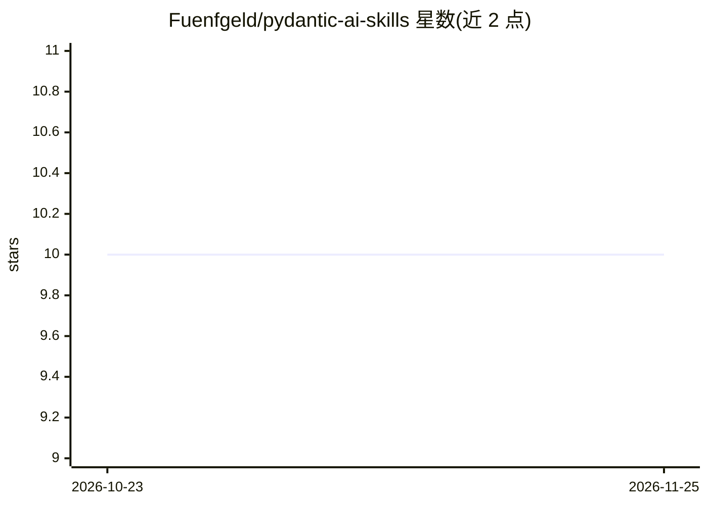

# Fuenfgeld/pydantic-ai-skills

⭐ 10 · Python · MIT · 推送 2026-10-17 · [GitHub](https://github.com/Fuenfgeld/pydantic-ai-skills) · 个人维护

**用 Pydantic AI 构建 AI agent 的 Claude Code 技能参考集**

为 Claude Code 提供两个技能目录：pydantic-ai-agents 覆盖依赖注入、系统提示词、工具调用、结构化输出、流式响应、多 agent 编排、会话记忆与 Logfire 可观测性等参考实现；pydantic-evals 提供类型安全数据集、多种评估器（确定性/LLM-as-Judge/自定义）等测试模式。所有示例经 34 个集成测试通过 OpenRouter 对真实 LLM 验证。面向使用 Claude Code 与 Pydantic AI 开发 agent 的开发者，以 git clone + uv/pip 方式安装。

## 筛选速览

| 维度 | 判定 | 备注 |
|---|---|---|
| AI 角色 | `ai-knowledge` | 知识聚合/清单类 |
| 许可风险 | `permissive` | MIT |
| 部署形态 | `library` | 以包/库形式分发 |
| 模型依赖 | — | README 未给出锁定关系 |
| 硬件要求 | — | 无带数字的原话,不猜 |
| 安装摩擦 | `low` | 无编译、无系统依赖或容器化 |
| 成熟度 | — | 结构信号不足 |

## 能力要点

- 两个技能包：agent 构建参考（9 种模式）与评估测试参考（EDD 工作流）
- 34 个集成测试经 OpenRouter 对真实 LLM 验证，另含 mock 单元测试
- 支持 OpenAI、Anthropic、OpenRouter 等多模型接入
- 内置 Logfire 可观测性与 trace 感知评估

## 适用场景

- 在 Claude Code 中查阅 Pydantic AI 的 agent 构建模式
- 为 AI agent 建立评估驱动的测试流程
- 搭建带依赖注入与多 agent 编排的生产级 agent

## 场景标签

`Agent 框架` `模型评测` `教程课程` · 领域:Agent 开发

## 证据(README 行号)

> L8: Production-ready **Claude Code skills** for building type-safe AI agents with **Pydantic AI**. Comprehensive referen
> L19: ## Skills Included
> L48: ## Installation

## 星数曲线

2026-10-23 10 → 2026-11-25 10（+0）

---
*卡片 v1 · prompt 1.4 · 生成 2026-11-20 · 置信度 high · 依据 README sha `716338051468` · [字段定义](../../DATASET.md)*
