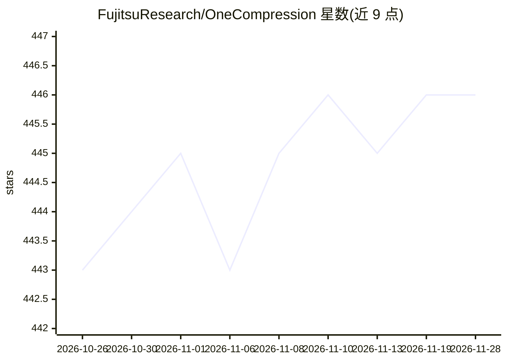

# FujitsuResearch/OneCompression

⭐ 446 · Python · MIT · 推送 2026-11-26 · [GitHub](https://github.com/FujitsuResearch/OneCompression) · [官网](https://fujitsuresearch.github.io/OneCompression/) · 组织维护

**面向开发者的 LLM 后训练量化压缩工具包**

Fujitsu 发布的 Python 包，将 LLM 压缩流程封装为单条命令：自动检测 GPU 显存、按层选择位宽、以误差传播方式量化、评估并保存。包含 QEP/LPCD/DBF/MDBF/JointQ 等多种 PTQ 量化方法，支持块级蒸馏、LoRA SFT 后处理、旋转预处理与 MoE 路由微调，可导出 GGUF 与 OpenVINO 格式。提供 vLLM 服务插件与 HPC Web 仪表盘。macOS 支持 GPTQ 量化与 MPS 推理，vLLM 服务仅限 Linux+NVIDIA GPU。

## 筛选速览

| 维度 | 判定 | 备注 |
|---|---|---|
| AI 角色 | `ai-ecosystem` | LLM/agent 周边工具 |
| 许可风险 | `permissive` | MIT |
| 部署形态 | `library` | 以包/库形式分发 |
| 模型依赖 | local-ok | 支持本地模型 |
| 硬件要求 | — | 无带数字的原话,不猜 |
| 安装摩擦 | `medium` | 含编译或系统依赖之一 |
| 成熟度 | — | 结构信号不足 |

## 能力要点

- 一条命令完成显存检测→位宽选择→量化→评估→保存
- 内置 vLLM 插件，可服务 DBF 与 Mixed-GPTQ 量化模型
- GGUF v3 无依赖导出，配合 llama.cpp/Ollama 使用
- 支持 ILP 混合精度位宽分配，按可用 VRAM 自动定目标位宽

## 适用场景

- 在显存预算内自动压缩模型并以 vLLM 本地部署
- 导出 GGUF 供 llama.cpp/Ollama 离线推理
- 对量化后模型做 LoRA 微调以恢复精度
- HPC 环境通过浏览器仪表盘批量发起量化任务

## 场景标签

`模型量化` `微调` · 领域:训练与推理

## 证据(README 行号)

> L3: Fujitsu One Compression (OneComp) is a Python package for LLM compression.
> L36: - **vLLM Plugin Integration**: Serve OneComp-quantized models with vLLM via built-in plugins for DBF and Mixed-GPTQ
> L34: - **Quantization Error Propagation (QEP)**: A post-training quantization method that corrects quantization errors b

## 星数曲线

2026-10-26 443 → 2026-11-28 446（+3）

---
*卡片 v1 · prompt 1.4 · 生成 2026-11-25 · 置信度 high · 依据 README sha `6805402984d4` · [字段定义](../../DATASET.md)*
