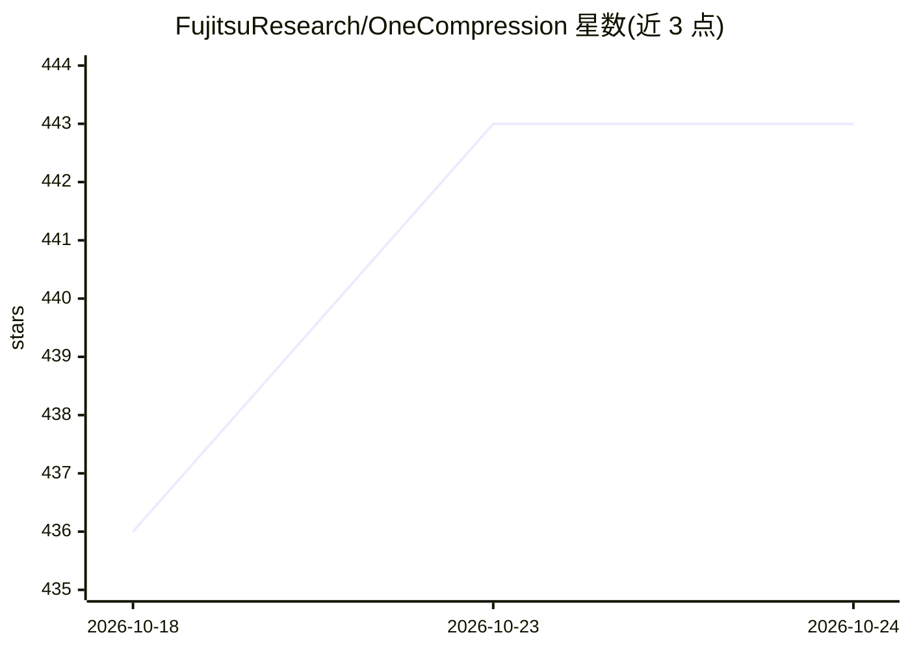

# FujitsuResearch/OneCompression

⭐ 443 · Python · MIT · 推送 2026-10-22 · [GitHub](https://github.com/FujitsuResearch/OneCompression) · [官网](https://fujitsuresearch.github.io/OneCompression/) · 组织维护

**面向 LLM 的自动量化压缩 Python 工具包**

Fujitsu 研究团队开发的 LLM 压缩 Python 包：一条命令检测 GPU VRAM、自动分配各层位宽、量化、评估并保存。提供 QEP（量化误差传播）、LPCD、AutoBit 混合精度、MDBF 亚 1 比特分解、块级/全局 PTQ、MoE 路由微调、LoRA 后处理、SpinQuant 旋转预处理等量化方法，并支持导出 GGUF（供 llama.cpp/Ollama）、OpenVINO、通过 vLLM 插件部署。已验证 Llama、Qwen3、Gemma、GPT-OSS 等架构；macOS 上支持 MPS 但 vLLM 部署需 Linux+NVIDIA GPU。

## 筛选速览

| 维度 | 判定 | 备注 |
|---|---|---|
| AI 角色 | `ai-ecosystem` | LLM/agent 周边工具 |
| 许可风险 | `permissive` | MIT |
| 部署形态 | `library` | 以包/库形式分发 |
| 模型依赖 | local-ok | 支持本地模型 |
| 硬件要求 | — | 无带数字的原话,不猜 |
| 安装摩擦 | `medium` | 含编译或系统依赖之一 |
| 成熟度 | — | 结构信号不足 |

## 能力要点

- 一条命令自动完成 VRAM 检测、逐层位宽分配、量化与评估（AutoBit/QEP）
- MDBF 亚 1 比特二值分解量化与 GemLite 加速 1 比特推理
- GGUF 导出（llama.cpp/Ollama）、OpenVINO 导出与 Hugging Face Hub 推送
- vLLM 插件（DBF、Mixed-GPTQ）部署量化后模型

## 适用场景

- 显存受限环境下把 LLM 压缩到可运行位宽
- 为 vLLM/llama.cpp/Ollama 产出量化模型
- 量化后用 LoRA 与蒸馏恢复精度

## 场景标签

`模型量化` · 领域:训练与推理

## 证据(README 行号)

> L3: Fujitsu One Compression (OneComp) is a Python package for LLM compression.
> L13: **That's all you need.** OneComp detects your GPU VRAM, picks the best bit-width per layer, quantizes with error pr

## 星数曲线

2026-10-18 436 → 2026-10-24 443（+7）

---
*卡片 v1 · prompt 1.4 · 生成 2026-10-22 · 置信度 high · 依据 README sha `c3148a120085` · [字段定义](../../DATASET.md)*
