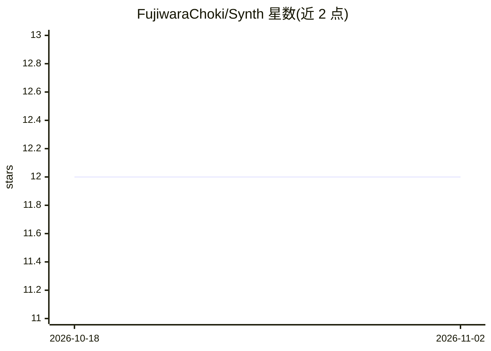

# FujiwaraChoki/Synth

⭐ 12 · Python · MIT · 推送 2025-11-20 · [GitHub](https://github.com/FujiwaraChoki/Synth) · 个人维护

**带 AI 聊天与图像生成功能的网页浏览器**

基于 Python 与 PyQt5/PyQtWebEngine 构建的网页浏览器，内置两项 AI 功能：与 AI 对话、生成 AI 图像，AI 能力通过 G4F 库获取。本体是浏览器应用，AI 功能依附于其上。安装方式为 git clone 源码后 pip 安装依赖，Linux 下另需运行 linux_setup.sh，以 python src/main.py 启动，无预编译安装包。MIT 许可，由个人开发者 FujiwaraChoki 维护。

## 筛选速览

| 维度 | 判定 | 备注 |
|---|---|---|
| AI 角色 | `ai-enhanced` | 去掉 AI 部分产品仍成立 |
| 许可风险 | `permissive` | MIT |
| 部署形态 | `library` | 以包/库形式分发 |
| 模型依赖 | — | README 未给出锁定关系 |
| 硬件要求 | — | 无带数字的原话,不猜 |
| 安装摩擦 | `low` | 无编译、无系统依赖或容器化 |
| 成熟度 | — | 结构信号不足 |

## 能力要点

- 网页浏览功能（PyQtWebEngine 渲染）
- 内置 AI 对话功能
- 内置 AI 图像生成功能
- 通过 G4F 库获取模型能力

## 适用场景

- 在浏览器内直接与 AI 对话
- 浏览网页的同时生成 AI 图像

## 场景标签

`图像生成` `聊天机器人` · 领域:对话与助手

## 证据(README 行号)

> L5: Synth is a web browser that uses AI to generate a unique experience for each user.
> L9: - Chat with AI
> L10: - Generate AI Images

## 星数曲线

2026-10-18 12 → 2026-11-02 12（+0）

---
*卡片 v1 · prompt 1.4 · 生成 2026-11-01 · 置信度 mid · 依据 README sha `573287269305` · [字段定义](../../DATASET.md)*
