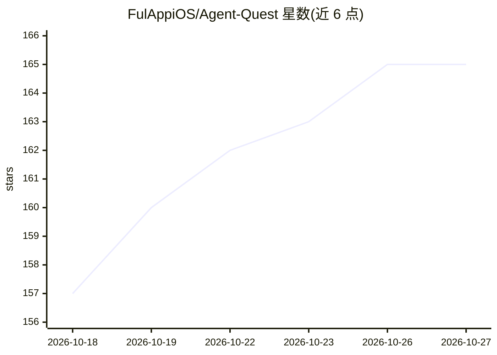

# FulAppiOS/Agent-Quest

⭐ 165 · TypeScript · MIT · 推送 2026-10-16 · [GitHub](https://github.com/FulAppiOS/Agent-Quest) · [官网](https://www.fulvioscichilone.it/agent-quest/) · 个人维护

**把 Claude Code/Codex 会话可视化为中世纪村庄英雄的实时监控面板**

浏览器端的 agent 监控仪表盘：自动发现本机 ~/.claude* 与 ~/.codex 的会话日志，把每个 Claude Code / Codex 会话渲染为 2D 奇幻村庄中的英雄，按其动作（Read 进图书馆、Edit 进铁匠铺等）在建筑间移动。提供每个会话的上下文窗口用量仪表、技能与插件遥测（加载次数与 token 注入量）、子代理层级展示，以及可粘贴给其他 AI 审查的 Markdown/JSON 导出。基于 Bun 运行，通过 WebSocket 实现亚 2 秒延迟；Claude Code 上下文窗口大小从日志推断（默认 200k），可用环境变量覆盖。macOS 提供一行安装脚本，其余平台 git clone 手动安装。

## 筛选速览

| 维度 | 判定 | 备注 |
|---|---|---|
| AI 角色 | `ai-ecosystem` | LLM/agent 周边工具 |
| 许可风险 | `permissive` | MIT |
| 部署形态 | `desktop` | 安装包/桌面程序 |
| 模型依赖 | — | README 未给出锁定关系 |
| 硬件要求 | — | 无带数字的原话,不猜 |
| 安装摩擦 | `low` | 无编译、无系统依赖或容器化 |
| 成熟度 | — | 结构信号不足 |

## 能力要点

- 实时可视化多个 Claude Code / Codex 会话及其活动
- 每个会话的上下文窗口用量仪表与压缩预警
- 技能/插件遥测：加载次数、注入 token 量、MCP 调用统计
- 一键导出会话数据（Markdown/JSON）供其他 AI 审查

## 适用场景

- 同时跑多个 agent 时一眼看清各自在做什么
- 监控上下文窗口余量、决定何时压缩或清理
- 查看各技能/插件对上下文的 token 消耗
- 把会话数据导出交给另一个 AI 做复盘审查

## 场景标签

`LLM 可观测性` · 领域:评测与运维

## 证据(README 行号)

> L13: Agent Quest is a browser-based monitoring dashboard that visualizes active Claude Code and Codex agent sessions as 
> L45: - Real-time visualization of active Claude Code and Codex sessions

## 星数曲线

2026-10-18 157 → 2026-10-27 165（+8）

---
*卡片 v1 · prompt 1.4 · 生成 2026-10-22 · 置信度 high · 依据 README sha `19ee3acfc809` · [字段定义](../../DATASET.md)*
