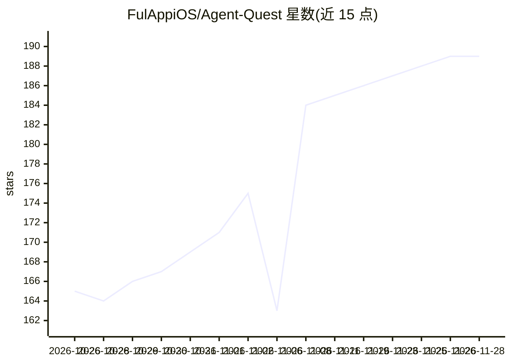

# FulAppiOS/Agent-Quest

⭐ 189 · TypeScript · MIT · 推送 2026-11-06 · [GitHub](https://github.com/FulAppiOS/Agent-Quest) · [官网](https://www.fulvioscichilone.it/agent-quest/) · 个人维护

**把 Claude Code 与 Codex 会话可视化为幻想村庄的监控仪表盘**

浏览器端仪表盘，读取 Claude Code 与 Codex 的本地会话日志（`~/.claude*`、`~/.codex` 及 macOS Xcode 存储目录），把每个运行中的 agent 会话渲染为 2D 村庄中的英雄：根据 Read/Edit/Bash 等动作在图书馆/铁匠铺/竞技场等建筑间移动。提供上下文窗口用量仪表、技能与插件 token 占用统计、主/子 agent 层级展示、活动流与 WebSocket 实时更新（2-3 秒轮询），并支持一键导出会话数据交给另一个 AI 审查。基于 Bun 运行，MIT 许可。

## 筛选速览

| 维度 | 判定 | 备注 |
|---|---|---|
| AI 角色 | `ai-ecosystem` | LLM/agent 周边工具 |
| 许可风险 | `permissive` | MIT |
| 部署形态 | `desktop` | 安装包/桌面程序 |
| 模型依赖 | — | README 未给出锁定关系 |
| 硬件要求 | — | 无带数字的原话,不猜 |
| 安装摩擦 | `low` | 无编译、无系统依赖或容器化 |
| 成熟度 | — | 结构信号不足 |

## 能力要点

- 实时可视化 Claude Code/Codex 会话，按工具调用类型移动英雄
- 每会话上下文窗口仪表与接近压缩阈值告警
- 技能/插件 token 占用遥测与子 agent 层级展示
- 导出 Markdown/JSON 会话报告供其他 AI 审查

## 适用场景

- 同时跑多个 Claude Code/Codex 会话时一眼掌握各自活动
- 监控各 agent 的上下文窗口用量，避免触发压缩
- 审查某个会话的技能/插件 token 消耗与子 agent 分工

## 场景标签

`LLM 可观测性` · 领域:评测与运维

## 证据(README 行号)

> L18: Agent Quest is an open-source, browser-based dashboard that turns your Claude Code and Codex sessions into fantasy 
> L59: - Session polling every 2–3 seconds with live WebSocket updates (optional lower-latency path via Claude Code `postT
> L66: - Claude Code or Codex with local session logs (`~/.claude*`, `~/.codex`, or Xcode’s agent storage on macOS). Witho

## 星数曲线

2026-10-26 165 → 2026-11-28 189（+24）

---
*卡片 v1 · prompt 1.4 · 生成 2026-11-26 · 置信度 high · 依据 README sha `4b1f5a50d4e2` · [字段定义](../../DATASET.md)*
