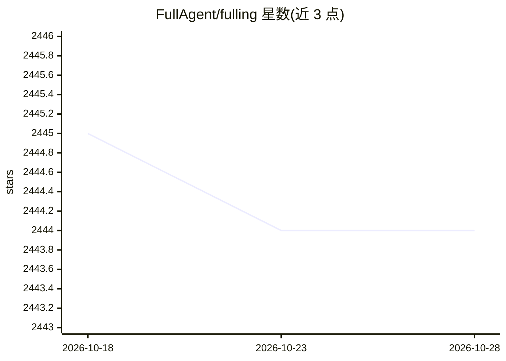

# FullAgent/fulling

⭐ 2,444 · TypeScript · MIT · 推送 2026-08-17 · [GitHub](https://github.com/FullAgent/fulling) · [官网](https://fulling.ai) · 组织维护

**AI 工作区平台基础：管理用户身份与 Kubernetes 凭据边界**

Fulling 定位为提供持久化 AI 工作区（技能、文件、记忆、脚本与运行时组合的环境），当前 v3 版本仅为基础层：通过 Better Auth 实现 GitHub 登录、PostgreSQL 存储用户/会话、每用户一份 kubeconfig，并通过 Kubernetes SelfSubjectReview 验证凭据，建立用户级 Kubernetes 客户端边界。凭据校验拒绝可执行插件、非 HTTPS API server 等；kubeconfig 以明文存于数据库。README 明确不含旧版兼容层，且不迁移 v2 数据。面向需要自建部署的开发者。

## 筛选速览

| 维度 | 判定 | 备注 |
|---|---|---|
| AI 角色 | `ai-ecosystem` | LLM/agent 周边工具 |
| 许可风险 | `permissive` | MIT |
| 部署形态 | `None` |  |
| 模型依赖 | — | README 未给出锁定关系 |
| 硬件要求 | — | 无带数字的原话,不猜 |
| 安装摩擦 | `low` | 无编译、无系统依赖或容器化 |
| 成熟度 | `idea` | |

## 能力要点

- GitHub 登录 + PostgreSQL 会话与用户存储
- kubeconfig 经 SelfSubjectReview 验证，设用户级 Kubernetes 客户端边界
- 凭据校验拒绝可执行插件、非 HTTPS API server、匿名身份等
- 支持 Vercel 原生 Next.js 部署，公开应用无需环境变量

## 适用场景

- 搭建 AI agent 的持久化工作区平台的身份与凭据基础
- 管理多用户的 Kubernetes 凭据并做边界控制
- 在 Vercel 或本地 Next.js 环境部署该基础层

## 场景标签

 · 领域:AI agent 基础设施/云原生

## 证据(README 行号)

> L3: Fulling is building dedicated AI workspaces: persistent environments that combine
> L4: skills, files, memory, scripts, and runtime. The current v3 foundation provides
> L19: Read docs/architecture.md for the target Workspace model.

## 星数曲线

2026-10-18 2,445 → 2026-10-28 2,444（-1）

---
*卡片 v1 · prompt 1.4 · 生成 2026-10-21 · 置信度 mid · 依据 README sha `2dff6666a576` · [字段定义](../../DATASET.md)*
