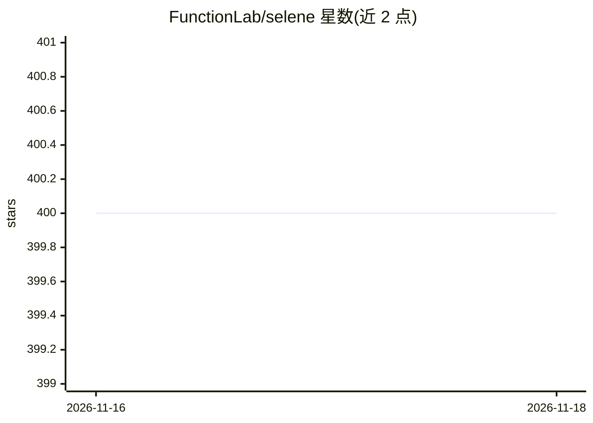

# FunctionLab/selene

⭐ 400 · Jupyter Notebook · BSD-3-Clause-Clear · 推送 2026-11-16 · [GitHub](https://github.com/FunctionLab/selene) · 组织维护

**训练基因组序列深度学习网络的 Python 框架**

Selene 是面向生物序列数据（如基因组）的深度神经网络训练框架，提供 CLI 与 selene-sdk Python API 两种使用方式：用户提供数据、模型结构与配置参数，Selene 执行训练、评估与预测（含变异效应预测、in silico mutagenesis），并含可视化组件。兼容 PyTorch 1.0.0–2.3.1，通过 conda/pip/源码安装；文档提示旧版 PyTorch 训练的模型权重与新版本不兼容，推荐在 CUDA GPU 上运行示例。

## 筛选速览

| 维度 | 判定 | 备注 |
|---|---|---|
| AI 角色 | `ai-ecosystem` | LLM/agent 周边工具 |
| 许可风险 | `viral` | BSD-3-Clause-Clear |
| 部署形态 | `library` | 以包/库形式分发 |
| 模型依赖 | — | README 未给出锁定关系 |
| 硬件要求 | — | 无带数字的原话,不猜 |
| 安装摩擦 | `high` | 编译与系统依赖俱全 |
| 成熟度 | — | 结构信号不足 |

## 能力要点

- CLI + Python API 双使用方式，支持训练/评估/预测序列模型
- 提供变异效应预测与 in silico mutagenesis 及可视化组件
- 含 Jupyter 教程与论文级 case studies（大据集训练示例）
- 支持序列分类与回归模型训练

## 适用场景

- 训练基因组序列分类或回归模型
- 对遗传变异做效应预测并接续统计分析
- 在笔记本上学习 API 与可视化用法，或在 GPU 节点复现论文案例

## 场景标签

`模型训练` · 领域:训练与推理

## 证据(README 行号)

> L3: Selene is a Python library and command line interface for training deep neural networks from biological sequence dat
> L57: Users supply their data, model architecture, and configuration parameters, and Selene runs the user-specified opera

## 星数曲线

2026-11-16 400 → 2026-11-18 400（+0）

---
*卡片 v1 · prompt 1.4 · 生成 2026-11-17 · 置信度 high · 依据 README sha `277706208375` · [字段定义](../../DATASET.md)*
