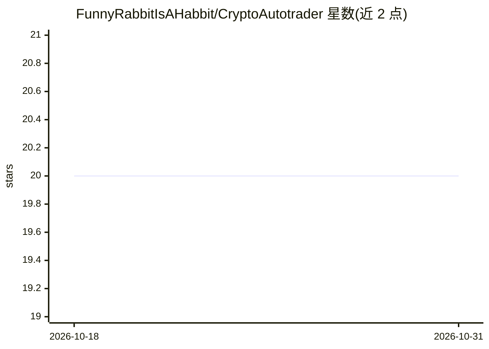

# FunnyRabbitIsAHabbit/CryptoAutotrader

⭐ 20 · Python · NOASSERTION · 推送 2026-02-24 · [GitHub](https://github.com/FunnyRabbitIsAHabbit/CryptoAutotrader) · 个人维护

**加密货币交易所现货自动交易机器人（架构模板）**

Python 3.13 编写的全自动加密货币现货交易机器人，通过 CCXT 库接入交易所，持续按预测信号下单买卖（价格与数量由参数化再投资率和溢价公式计算）。预测层三选一：Pandas/stockstats 技术指标交叉、LLM（任何 openai 库支持的 API）或带概率阈值的 LLM。全部配置通过 .env 环境变量完成。README 声明当前形态很可能亏损、仅作教学示例；Windows 与 Docker 均未测试。存在付费高级版。

## 筛选速览

| 维度 | 判定 | 备注 |
|---|---|---|
| AI 角色 | `ai-enhanced` | 去掉 AI 部分产品仍成立 |
| 许可风险 | `none` | NOASSERTION |
| 部署形态 | `library` | 以包/库形式分发 |
| 模型依赖 | — | README 未给出锁定关系 |
| 硬件要求 | — | 无带数字的原话,不猜 |
| 安装摩擦 | `low` | 无编译、无系统依赖或容器化 |
| 成熟度 | — | 结构信号不足 |

## 能力要点

- 经 CCXT 支持多家交易所的现货全自动下单
- 预测后端可选 Pandas 指标、LLM 或概率阈值 LLM（openai 库兼容 API）
- test 模式只调用预测 API 不实际下单
- 设计可长期运行，含错误处理与订单撤销逻辑

## 适用场景

- 我想让机器人在交易所按技术指标信号自动现货交易
- 我想测试自己的 LLM 交易策略而不实际下单
- 作为自动交易系统的架构模板进行二次开发

## 场景标签

`金融量化` · 领域:学习与行业

## 证据(README 行号)

> L19: Currently, it utilizes several naive approaches to spot trading (either price-related crossovers or
> L32: * LLM connection is through any 'openai' library supported API
> L104: `DEFAULT_PREDICTION_API` – either `LLM` or `PROBABILITY_LLM`, or `PANDAS` is supported

## 星数曲线

2026-10-18 20 → 2026-10-31 20（+0）

---
*卡片 v1 · prompt 1.4 · 生成 2026-10-28 · 置信度 mid · 依据 README sha `60c609ba0422` · [字段定义](../../DATASET.md)*
