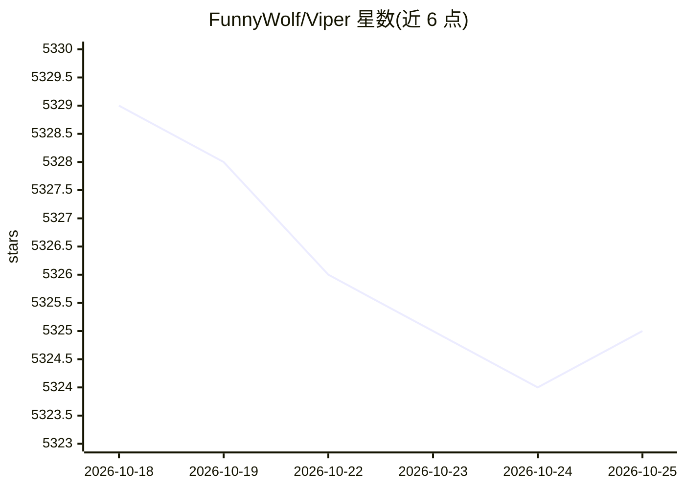

# FunnyWolf/Viper

⭐ 5,332 · 推送 2026-05-31 · [GitHub](https://github.com/FunnyWolf/Viper) · [官网](https://www.viperrtp.com) · 个人维护 · 中文 README

**面向红队的对抗模拟平台，集成100+后渗透模块与LLM Agent**

VIPER 是一个红队平台，整合对手模拟与红队行动所需工具，覆盖 MITRE ATT&CK 各阶段，内置 100 余个后渗透模块，支持 Windows/Linux/macOS 多平台植入，提供可视化界面、Python 自定义模块开发、自动化编排与通知、反追踪/防御规避/跳板图等功能。其中 AI 部分为内置 LLM Agent，用于自动化处理与决策支持。产品对比表将自身与 Cobalt Strike、NightHawk、BruteRatel 并列（后三者收费，VIPER 免费）。提供 Docker 镜像。

## 筛选速览

| 维度 | 判定 | 备注 |
|---|---|---|
| AI 角色 | `ai-enhanced` | 去掉 AI 部分产品仍成立 |
| 许可风险 | `none` | — |
| 部署形态 | `self-host` | docker 或自建部署 |
| 模型依赖 | — | README 未给出锁定关系 |
| 硬件要求 | — | 无带数字的原话,不猜 |
| 安装摩擦 | `low` | 无编译、无系统依赖或容器化 |
| 成熟度 | — | 结构信号不足 |

## 能力要点

- 覆盖 MITRE ATT&CK 各阶段的 100+ 后渗透模块
- 内置 LLM Agent 提供自动化处理与决策支持
- Windows/Linux/macOS 多平台植入与跳板图
- Python 自定义模块扩展与自动化工作流

## 适用场景

- 红队开展多平台渗透测试与对手模拟
- 通过 LLM Agent 辅助自动化任务处理
- 7x24 小时目标环境监控与自动化通知

## 场景标签

`网络安全` · 领域:学习与行业

## 证据(README 行号)

> L38: - **Integrated LLM Agent**
> L71: |LLM Agent|✅|❌|❌|❌|

## 星数曲线

2026-10-18 5,329 → 2026-10-25 5,325（-4）

---
*卡片 v1 · prompt 1.4 · 生成 2026-10-20 · 置信度 mid · 依据 README sha `f4102286e3c0` · [字段定义](../../DATASET.md)*
