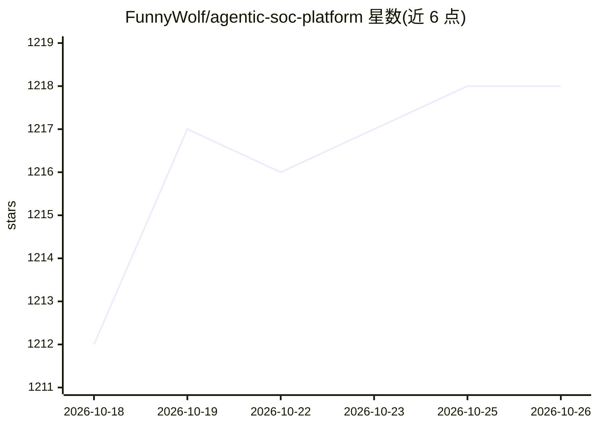

# FunnyWolf/agentic-soc-platform

⭐ 1,218 · Python · 推送 2026-09-29 · [GitHub](https://github.com/FunnyWolf/agentic-soc-platform) · [官网](https://asp.viperrtp.com) · 个人维护 · 中文 README

**给安全运营团队：用 AI agent 做告警分诊与调查的开源 SOC 平台**

基于 Agentic AI 的开源安全运营平台：接入 SIEM 与 Webhook 告警，提取 IOC 并关联生成 Case/Alert/Artifact；由 LLM 与 agent 自动产出严重度、置信度、结论与结构化调查报告；通过 Playbook 编排 LLM 分析与 SOAR 流程，并支持威胁情报与 CMDB 富化。支持 Splunk/ELK 日志检索，向 Claude Code / Codex / OpenCode 等 Harness Agent 开放 CLI 与插件，含 LDAP 登录、角色、审计等治理功能。MIT 许可，支持完全本地化部署，后端 Python、前端 TypeScript，用 Python Module 适配新告警源。限制：README 未给出具体安装命令与硬件要求。

## 筛选速览

| 维度 | 判定 | 备注 |
|---|---|---|
| AI 角色 | `ai-native` | 本体是模型或模型工具 |
| 许可风险 | `none` | — |
| 部署形态 | `None` |  |
| 模型依赖 | — | README 未给出锁定关系 |
| 硬件要求 | — | 无带数字的原话,不猜 |
| 安装摩擦 | `low` | 无编译、无系统依赖或容器化 |
| 成熟度 | — | 结构信号不足 |

## 能力要点

- SIEM/Webhook 告警汇聚为 Case/Alert/Artifact，自动提取 IOC 并关联信号
- LLM 调查自动产出严重度、置信度、结论与结构化调查报告
- Playbook 同时编排 SOAR 流程与 LLM 分析，一键驱动复杂调查
- 通过 CLI 与插件向 Claude Code / Codex / OpenCode 等 Harness Agent 开放平台能力

## 适用场景

- 把海量安全告警收敛为少量可处置的案件并自动完成初步调查
- 让安全分析师与 AI agent 在同一日志与情报上下文中协作
- 在自有网络内私有化部署 AI 辅助的安全运营平台

## 场景标签

`网络安全` · 领域:学习与行业

## 证据(README 行号)

> L19: **Agentic SOC Platform** is an open-source security operations platform built on Agentic AI, enabling agents to pro
> L29: Compress hours of manual analysis into seconds, automatically producing severity, confidence, impact, priority, ver
> L35: Launch LLM investigation, knowledge extraction, threat intelligence enrichment, and CMDB enrichment around each Cas

## 星数曲线

2026-10-18 1,212 → 2026-10-26 1,218（+6）

---
*卡片 v1 · prompt 1.4 · 生成 2026-10-21 · 置信度 mid · 依据 README sha `43662cab259b` · [字段定义](../../DATASET.md)*
