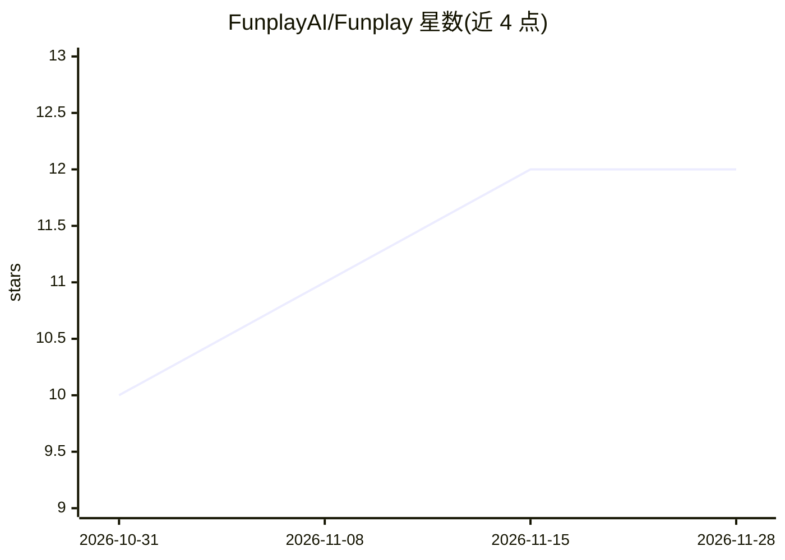

# FunplayAI/Funplay

⭐ 12 · TypeScript · MIT · 推送 2026-07-31 · [GitHub](https://github.com/FunplayAI/Funplay) · [官网](https://funplay.top/) · 组织维护 · 中文 README

**游戏开发者的 AI Agent 工作台：跨引擎生成与维护项目**

基于 Electron + React 的开源桌面应用，将本地优先工作区、内置多 Provider 的 AI Agent 运行时、引擎适配、MCP 集成、文件编辑、终端工具、浏览器检查与资产生成工作流组合在一起。用户描述游戏想法后，Agent 可规划任务、读写项目文件、运行命令与检查、生成图像/UI/音频/3D 等资产。支持 Unity、Cocos、Godot 真实适配器，Unreal 为占位响应；API 密钥存于主进程密钥存储，不下发给渲染进程。开发模式通过 npm 运行，无安装包说明。

## 筛选速览

| 维度 | 判定 | 备注 |
|---|---|---|
| AI 角色 | `ai-ecosystem` | LLM/agent 周边工具 |
| 许可风险 | `permissive` | MIT |
| 部署形态 | `library` | 以包/库形式分发 |
| 模型依赖 | locked-api |  |
| 硬件要求 | — | 无带数字的原话,不猜 |
| 安装摩擦 | `low` | 无编译、无系统依赖或容器化 |
| 成熟度 | — | 结构信号不足 |

## 能力要点

- 内置多 Provider Agent 运行时：Anthropic、Google、Bedrock、Vertex、OpenAI 兼容端点
- Unity/Cocos/Godot 真实引擎适配器，含 MCP 桥接安装与运行时状态检查
- 资产生成任务覆盖图像、UI、纹理、音频、3D、动画
- 权限代理、命令沙箱、写入检查点与可回放操作日志

## 适用场景

- 从粗略游戏概念生成可执行的实施计划并推进到可玩原型
- 让 Agent 在 Unity/Cocos/Godot 项目中执行文件修改、命令运行与引擎桥接
- 为游戏项目批量生成图像、音频、3D 等资产
- 在本地保存密钥、会话与生成资产记录的游戏开发环境

## 场景标签

`编码 Agent` `图像生成` `AI 助手` · 领域:编码与开发

## 证据(README 行号)

> L14: Funplay helps game ideas survive contact with the actual project. It combines a local-first Electron workspace, a b
> L44: ## Agent Runtime
> L76: - `electron/main/agent-platform/native/` owns the built-in provider loop for Anthropic, Google, Bedrock, Vertex, Op

## 星数曲线

2026-10-31 10 → 2026-11-28 12（+2）

---
*卡片 v1 · prompt 1.4 · 生成 2026-11-18 · 置信度 high · 依据 README sha `30025d72e7a0` · [字段定义](../../DATASET.md)*
