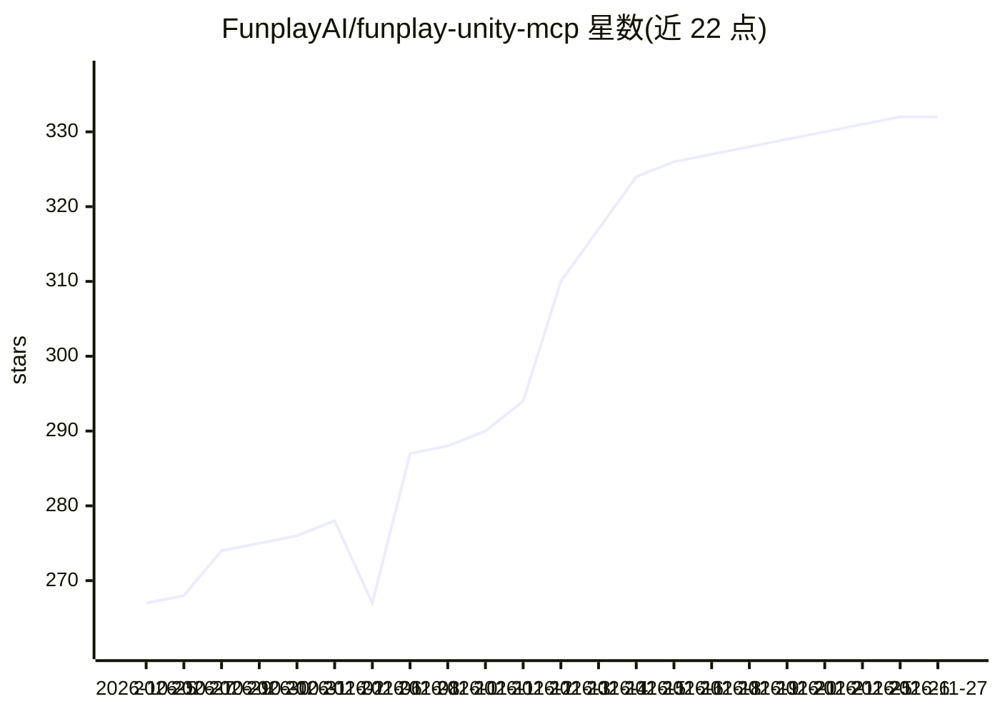

# FunplayAI/funplay-unity-mcp

⭐ 332 · C# · MIT · 推送 2026-11-23 · [GitHub](https://github.com/FunplayAI/funplay-unity-mcp) · 组织维护 · 中文 README

**让 AI 编码助手直接操作 Unity 编辑器的 MCP Server**

MIT 许可的 Unity Editor MCP 服务器，通过 execute_code、场景创建、脚本生成、运行时验证、输入模拟、截图与 Play Mode 自动化等工具，让接入 MCP 的 AI 客户端在运行中的 Unity 工程内执行操作。支持每个工程独立端口、HTTP 传输与实验性 Broker 模式，提供一键写入多种客户端 MCP 配置和项目 Skills 的功能。要求 Unity 2022.3+，仅限编辑器内运行。

## 筛选速览

| 维度 | 判定 | 备注 |
|---|---|---|
| AI 角色 | `ai-ecosystem` | LLM/agent 周边工具 |
| 许可风险 | `permissive` | MIT |
| 部署形态 | `None` |  |
| 模型依赖 | — | README 未给出锁定关系 |
| 硬件要求 | — | 无带数字的原话,不猜 |
| 安装摩擦 | `low` | 无编译、无系统依赖或容器化 |
| 成熟度 | — | 结构信号不足 |

## 能力要点

- 提供 execute_code、场景创建、脚本生成、运行时验证、输入模拟、截图与 Play Mode 自动化等 MCP 工具
- 每个工程按路径派生独立端口，支持固定端口与实验性 Broker 模式
- 提供一键配置，将 MCP 条目写入 Claude Code、Cursor、VS Code、Codex 等客户端配置文件
- 内置 unity-mcp-workflow 与 unity-ui-composition 两个项目 Skills

## 适用场景

- 用一句自然语言描述让 AI 在 Unity 中生成场景、脚本与 UI
- 在 Unity 编辑器运行期间让 AI 客户端执行代码并验证结果
- 为团队统一的 MCP 客户端配置写入项目级 Skills 与工具暴露规则

## 场景标签

`代码生成` · 领域:编码与开发

## 证据(README 行号)

> L16: Funplay MCP for Unity is an MIT-licensed Unity Editor MCP server that lets AI assistants like Claude Code, Cursor, 
> L18: Describe your game in one sentence — your AI assistant builds it in Unity through Funplay MCP for Unity's built-in 

## 星数曲线

2026-10-25 267 → 2026-11-27 332（+65）

---
*卡片 v1 · prompt 1.4 · 生成 2026-11-25 · 置信度 high · 依据 README sha `99154a882425` · [字段定义](../../DATASET.md)*
