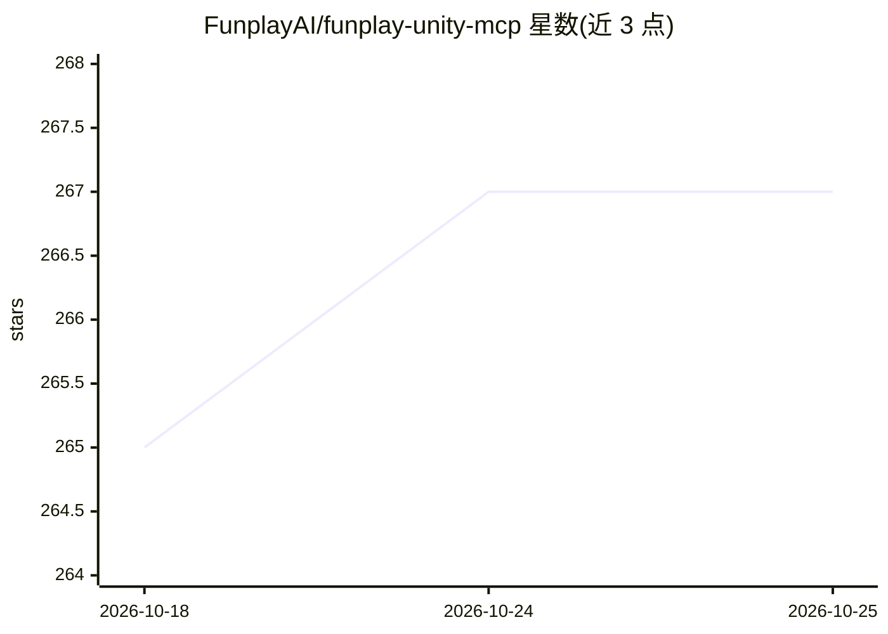

# FunplayAI/funplay-unity-mcp

⭐ 267 · C# · MIT · 推送 2026-10-08 · [GitHub](https://github.com/FunplayAI/funplay-unity-mcp) · 组织维护 · 中文 README

**让 AI 助手直接操作 Unity 编辑器的 MCP 服务器**

MIT 许可的 Unity Editor 专用 MCP 服务器（Unity 2022.3+，仅编辑器运行、不进入游戏运行时）。它使 Claude Code、Cursor、Codex、Kimi Code、LM Studio、Windsurf、VS Code Copilot 等客户端能在运行中的 Unity 项目里执行场景创建、脚本生成、运行时验证、输入模拟、截图与编辑器自动化。默认暴露 40 个 core 工具，full 模式含 180 个工具；execute_code 带默认开启的安全检查与文件系统守卫。支持按项目派生端口（20000-29999）与一键写入各客户端配置。

## 筛选速览

| 维度 | 判定 | 备注 |
|---|---|---|
| AI 角色 | `ai-ecosystem` | LLM/agent 周边工具 |
| 许可风险 | `permissive` | MIT |
| 部署形态 | `None` |  |
| 模型依赖 | locked-api |  |
| 硬件要求 | — | 无带数字的原话,不猜 |
| 安装摩擦 | `low` | 无编译、无系统依赖或容器化 |
| 成熟度 | — | 结构信号不足 |

## 能力要点

- core 模式 40 个工具 / full 模式 180 个工具，覆盖场景编辑、UI 审计、输入模拟、截图等
- 一键为 Claude Code、Cursor、Codex、Kimi、LM Studio 等十余种客户端写入 MCP 配置
- execute_code 默认启用安全检查与文件系统守卫，客户端可按调用覆盖
- 按项目派生端口支持多 Unity 项目并行，内置 unity-mcp-workflow / unity-ui-composition 项目技能

## 适用场景

- 用一句话让 AI 助手在 Unity 里搭建原型或小游戏
- 让 AI 客户端读取/修改 Unity 场景、脚本与 UI 并验证运行结果
- 多 Unity 项目同时开启时各自连接独立的 MCP 服务

## 场景标签

 · 领域:游戏开发/AI 工具接入

## 证据(README 行号)

> L16: Funplay MCP for Unity is an MIT-licensed Unity Editor MCP server that lets AI assistants like Claude Code, Cursor, 
> L18: Describe your game in one sentence — your AI assistant builds it in Unity through Funplay MCP for Unity's built-in 

## 星数曲线

2026-10-18 265 → 2026-10-25 267（+2）

---
*卡片 v1 · prompt 1.4 · 生成 2026-10-22 · 置信度 high · 依据 README sha `2c02239006e1` · [字段定义](../../DATASET.md)*
