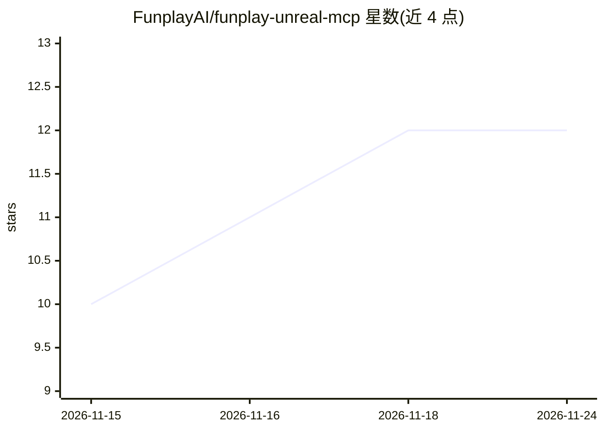

# FunplayAI/funplay-unreal-mcp

⭐ 12 · Python · MIT · 推送 2026-06-23 · [GitHub](https://github.com/FunplayAI/funplay-unreal-mcp) · 组织维护 · 中文 README

**让 AI 客户端通过 MCP 直接操作 Unreal 编辑器的插件服务**

纯 Python 的 Unreal Editor 插件（依赖引擎 Python Editor Script Plugin，无 C++ 编译），在编辑器内启动本地 MCP 服务器（默认 127.0.0.1:8765，带按项目生成的 auth token），并通过零依赖 Node.js stdio 桥连接 Claude Code、Cursor、VS Code Copilot、Codex 等 MCP 客户端。提供 97 个内置工具（默认 core 配置 32 个）、prompt 模板、unreal:// 资源、execute_python 任意执行、API 发现、截图与 Play-In-Editor 自动化。仅限编辑器内使用，不随打包游戏分发。支持 UE 5.3–5.8，MIT 许可。

## 筛选速览

| 维度 | 判定 | 备注 |
|---|---|---|
| AI 角色 | `ai-ecosystem` | LLM/agent 周边工具 |
| 许可风险 | `permissive` | MIT |
| 部署形态 | `None` |  |
| 模型依赖 | — | README 未给出锁定关系 |
| 硬件要求 | — | 无带数字的原话,不猜 |
| 安装摩擦 | `low` | 无编译、无系统依赖或容器化 |
| 成熟度 | — | 结构信号不足 |

## 能力要点

- 97 个内置工具（默认 core 配置 32 个），含 execute_python 任意 Python 执行
- 内置 API 发现（search_api/describe_class/inspect_object）读取 unreal 模块文档
- MCP resources 与 prompt 模板，工具返回结构化 JSON，截图内联返回
- 一键写入 Claude Code/Cursor/VS Code/Codex 客户端配置

## 适用场景

- 用自然语言让 AI 助手在编辑器内搭建关卡、Actor、材质与蓝图
- AI 驱动 Play-In-Editor 并返回截图做运行验证
- 让助手查询真实 unreal API 并执行 Python 脚本做自动化编辑

## 场景标签

 · 领域:游戏开发/AI 工具链

## 证据(README 行号)

> L13: Funplay MCP for Unreal lets AI assistants — **Claude Code, Cursor, Windsurf, Codex,
> L16: Unreal Engine 5.3–5.8) that exposes the editor over a local MCP server, plus a

## 星数曲线

2026-11-15 10 → 2026-11-24 12（+2）

---
*卡片 v1 · prompt 1.4 · 生成 2026-11-18 · 置信度 high · 依据 README sha `35e8300d3bc8` · [字段定义](../../DATASET.md)*
