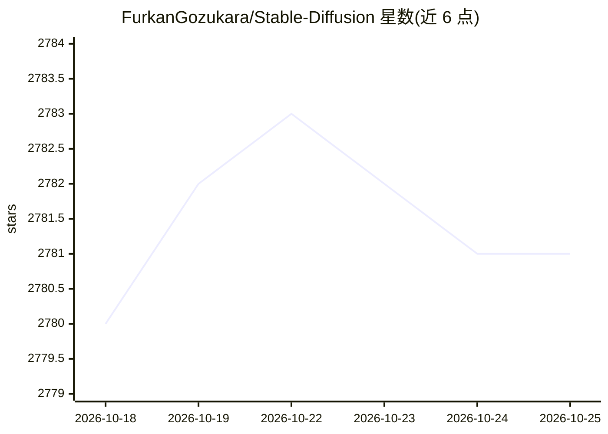

# FurkanGozukara/Stable-Diffusion

⭐ 2,781 · Jupyter Notebook · GPL-3.0 · 推送 2026-10-19 · [GitHub](https://github.com/FurkanGozukara/Stable-Diffusion) · [官网](https://www.youtube.com/SECourses) · 组织维护

**SECourses 生成式 AI 视频教程索引清单**

由 Dr. Furkan Gözükara（SECourses YouTube 频道，4.8 万订阅）维护的教程视频索引仓库：以 74+ 条表格条目罗列 Stable Diffusion、SDXL、DreamBooth、LoRA 训练、ControlNet、ComfyUI、RunPod/Colab/Kaggle 云端使用、Deepfake、图像放大等主题的 YouTube 教程链接，并汇总 Patreon、Discord 等社区入口。仓库本体为清单文档，不包含可运行代码；作者声明持续更新并接受建议。

## 筛选速览

| 维度 | 判定 | 备注 |
|---|---|---|
| AI 角色 | `ai-knowledge` | 知识聚合/清单类 |
| 许可风险 | `viral` | GPL-3.0 |
| 部署形态 | `None` |  |
| 模型依赖 | — | README 未给出锁定关系 |
| 硬件要求 | — | 无带数字的原话,不猜 |
| 安装摩擦 | `medium` | 含编译或系统依赖之一 |
| 成熟度 | — | 结构信号不足 |

## 能力要点

- 74+ 条教程条目按序号表格组织，覆盖 SD/SDXL 训练与云端部署
- 涉及 RunPod、Google Colab、Kaggle 等免费/付费云端环境
- 汇总 YouTube、Patreon、Discord 等社区与平台链接

## 适用场景

- 查找 Stable Diffusion 从安装到 LoRA 训练的分步视频教程
- 对比云端（RunPod/Colab/Kaggle）运行 SDXL 的方案
- 加入 Discord 社区交流生成式 AI 工作流

## 场景标签

`教程课程` `精选清单` · 领域:学习与行业

## 证据(README 行号)

> L6: # Expert-Level Tutorials on Generative AI
> L41: ## Tutorial Videos
> L43: |||

## 星数曲线

2026-10-18 2,780 → 2026-10-25 2,781（+1）

---
*卡片 v1 · prompt 1.4 · 生成 2026-10-21 · 置信度 high · 依据 README sha `8403d168e046` · [字段定义](../../DATASET.md)*
