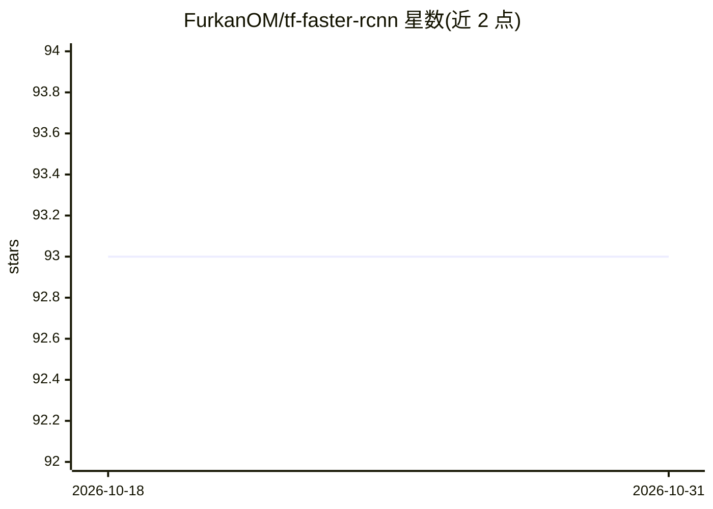

# FurkanOM/tf-faster-rcnn

⭐ 93 · Python · Apache-2.0 · 推送 2026-03-30 · [GitHub](https://github.com/FurkanOM/tf-faster-rcnn) · 个人维护

**TensorFlow 2 从零实现的 Faster R-CNN 目标检测库**

用 TensorFlow 2 从零实现的 Faster R-CNN 目标检测代码库，支持批量处理，方法按论文与 tf-rpn 仓库的描述编写以求易于理解。支持 MobileNetV2（默认）与 VGG16 两种骨干网络，可通过 --backbone 参数切换；可训练/测试完整 Faster R-CNN，也可单独训练 RPN。通过 conda environment.yml 创建虚拟环境，训练示例使用 VOC 0712 数据集；仓库附带 make lint/test 本地检查与相关论文、数据集引用。

## 筛选速览

| 维度 | 判定 | 备注 |
|---|---|---|
| AI 角色 | `ai-native` | 本体是模型或模型工具 |
| 许可风险 | `permissive` | Apache-2.0 |
| 部署形态 | `None` |  |
| 模型依赖 | — | README 未给出锁定关系 |
| 硬件要求 | — | 无带数字的原话,不猜 |
| 安装摩擦 | `low` | 无编译、无系统依赖或容器化 |
| 成熟度 | — | 结构信号不足 |

## 能力要点

- TensorFlow 2 从零实现的 Faster R-CNN，支持批量处理
- 支持 MobileNetV2（默认）与 VGG16 两种骨干网络
- 支持完整模型与 RPN 单独的训练/预测脚本
- 包含 make lint/test 本地质量检查命令

## 适用场景

- 学习 Faster R-CNN 的从零实现细节
- 在 VOC 数据集上训练目标检测模型
- 对比不同骨干网络的目标检测效果

## 场景标签

`目标检测` · 领域:感知与多模态

## 证据(README 行号)

> L3: This is tensorflow Faster-RCNN implementation from scratch supporting to the batch processing.
> L7: It's implemented and tested with **tensorflow 2.0**.

## 星数曲线

2026-10-18 93 → 2026-10-31 93（+0）

---
*卡片 v1 · prompt 1.4 · 生成 2026-10-23 · 置信度 high · 依据 README sha `ff0c3b181e77` · [字段定义](../../DATASET.md)*
