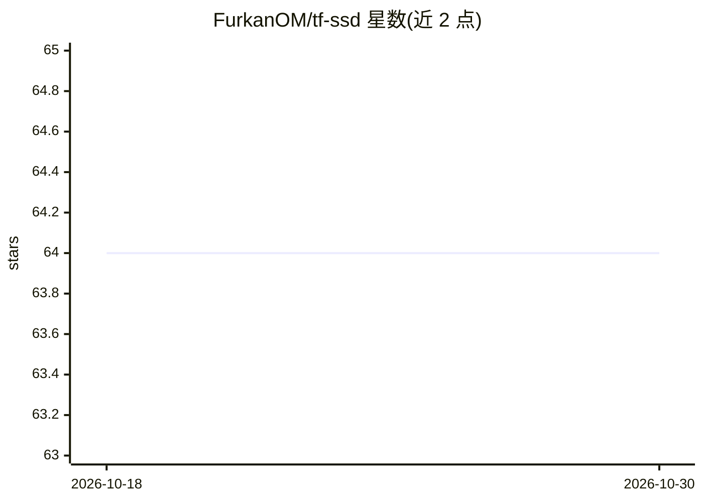

# FurkanOM/tf-ssd

⭐ 64 · Python · Apache-2.0 · 推送 2026-04-02 · [GitHub](https://github.com/FurkanOM/tf-ssd) · 个人维护

**TensorFlow 2 从零实现的 SSD 目标检测器，支持双主干网络**

以 TensorFlow 2 从零实现的 Single Shot MultiBox Detector（SSD）目标检测模型，支持 VGG16 与 MobileNetV2 两种主干网络，在 TensorFlow 2.0/2.1/2.2 上实现并测试。提供 trainer.py 与 predictor.py 脚本，通过 --backbone 参数选择主干，用 VOC 0712 数据集训练并提供示例检测结果。环境通过 conda 与 environment.yml 创建，含 -handle-gpu 标志处理 GPU 问题，另提供 make lint/test/check 本地质量检查。

## 筛选速览

| 维度 | 判定 | 备注 |
|---|---|---|
| AI 角色 | `ai-native` | 本体是模型或模型工具 |
| 许可风险 | `permissive` | Apache-2.0 |
| 部署形态 | `None` |  |
| 模型依赖 | — | README 未给出锁定关系 |
| 硬件要求 | — | 无带数字的原话,不猜 |
| 安装摩擦 | `low` | 无编译、无系统依赖或容器化 |
| 成熟度 | — | 结构信号不足 |

## 能力要点

- 从零实现的 SSD，支持 VGG16 与 MobileNetV2 主干网络
- 在 TensorFlow 2.0/2.1/2.2 上实现并测试
- 提供 trainer.py / predictor.py 训练与预测脚本
- 提供依赖 make lint/test/check 质量检查命令

## 适用场景

- 用 VOC 0712 数据训练 SSD 目标检测模型
- 学习 SSD 架构的 TensorFlow 2 从零实现
- 对比 VGG16 与 MobileNetV2 主干在检测任务上的使用

## 场景标签

`目标检测` · 领域:感知与多模态

## 证据(README 行号)

> L1: # Single Shot MultiBox Detector
> L3: Tensorflow SSD implementation from scratch. MobileNetV2 and VGG16 backbones are supported.
> L24: python trainer.py --backbone mobilenet_v2

## 星数曲线

2026-10-18 64 → 2026-10-30 64（+0）

---
*卡片 v1 · prompt 1.4 · 生成 2026-10-24 · 置信度 high · 依据 README sha `f0649a5a9248` · [字段定义](../../DATASET.md)*
