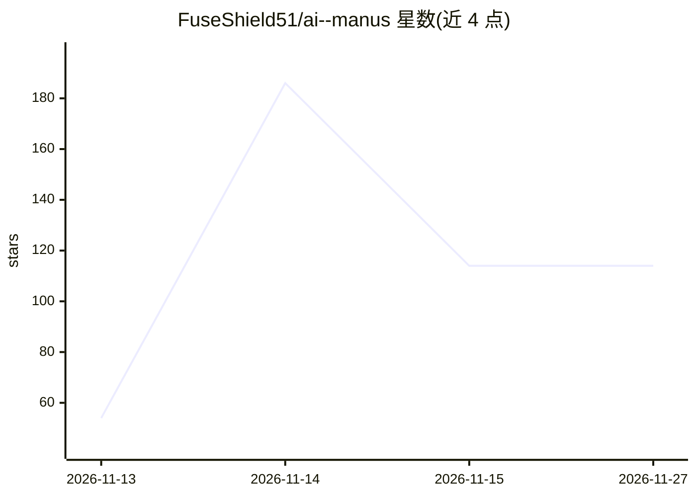

# FuseShield51/ai--manus

⭐ 114 · Apache-2.0 · 推送 2026-11-15 · [GitHub](https://github.com/FuseShield51/ai--manus) · 个人维护

**自主 AI Agent 系统：代用户执行代码与控制浏览器完成任务**

Manus 是面向家庭、学习与轻量办公场景的自主 AI Agent：用户以自然语言下达指令，agent 自行编写并执行脚本、控制浏览器（导航网页、填写表单、采集信息）、跨会话复用工作流模式，完成多步骤任务。README 说明其定位为小型任务助手而非企业平台，最低要求 64 位系统、双核 CPU、4 GB 内存。README 未给出具体安装命令、模型接入方式或代码仓库结构，仅提供使用流程描述与搜索词列表。

## 筛选速览

| 维度 | 判定 | 备注 |
|---|---|---|
| AI 角色 | `ai-native` | 本体是模型或模型工具 |
| 许可风险 | `permissive` | Apache-2.0 |
| 部署形态 | `None` |  |
| 模型依赖 | — | README 未给出锁定关系 |
| 硬件要求 | — | 无带数字的原话,不猜 |
| 安装摩擦 | `low` | 无编译、无系统依赖或容器化 |
| 成熟度 | — | 结构信号不足 |

## 能力要点

- 自主执行代码：agent 自行编写并运行脚本完成任务
- 浏览器控制：导航网页、填写表单、采集多页信息
- 代码与浏览器在同一流程中衔接，支持多步骤任务

## 适用场景

- 让学生整理研究笔记、跑小型计算脚本
- 让 agent 代为浏览多个网页并汇总信息
- 远程工作者用其采集数据、准备小型报告

## 场景标签

`浏览器自动化` `编码 Agent` · 领域:效率与自动化

## 证据(README 行号)

> L10: - **Autonomous Code Execution:** Manus AI agent runs code on its own to complete tasks, so you can focus on decisio
> L18: Manus is an autonomous AI agent designed to run code and control a browser on your behalf. Instead of acting like a

## 星数曲线

2026-11-13 54 → 2026-11-27 114（+60）

---
*卡片 v1 · prompt 1.4 · 生成 2026-11-17 · 置信度 mid · 依据 README sha `a3d88e202bf0` · [字段定义](../../DATASET.md)*
