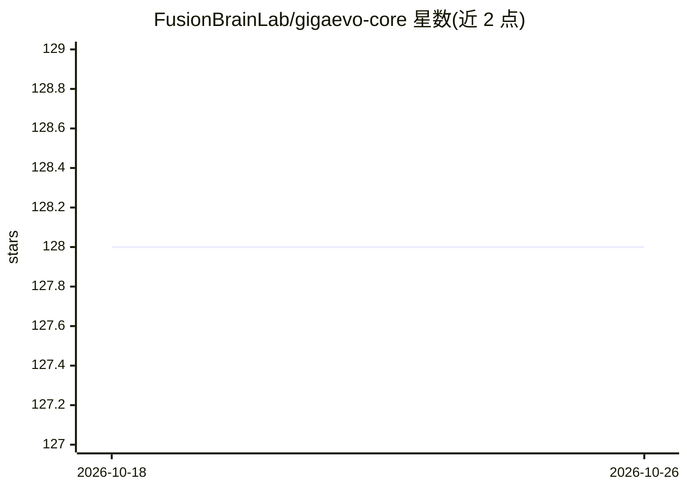

# FusionBrainLab/gigaevo-core

⭐ 128 · Python · MIT · 推送 2026-08-17 · [GitHub](https://github.com/FusionBrainLab/gigaevo-core) · [官网](https://airi-institute.github.io/gigaevo-cover/) · 组织维护

**用 LLM 做变异算子的进化算法框架，自动迭代改进程序**

基于 MAP-Elites 的 Python 进化算法框架：将候选解表示为 Python 函数，由 LLM（GPT/Claude/Gemini/Qwen 等，经 OpenAI 兼容端点或 OpenRouter）执行变异生成子代程序，通过运行 entrypoint()/validate() 评估适应度并迭代选择。支持单岛/多岛进化、提示词协同进化、记忆增强变异（memory v2 跨运行记忆卡）、对抗性双种群协同进化，以及用 agentic 编码 CLI（Claude Code/Codex）替代 HTTP 端点作为变异引擎。任务无关，采用 Hydra 模块化配置，磁盘存储为默认、Redis 可选。面向需要自动程序优化与进化实验的研究/开发者。

## 筛选速览

| 维度 | 判定 | 备注 |
|---|---|---|
| AI 角色 | `ai-ecosystem` | LLM/agent 周边工具 |
| 许可风险 | `permissive` | MIT |
| 部署形态 | `library` | 以包/库形式分发 |
| 模型依赖 | local-ok | 支持本地模型 |
| 硬件要求 | — | 无带数字的原话,不猜 |
| 安装摩擦 | `low` | 无编译、无系统依赖或容器化 |
| 成熟度 | — | 结构信号不足 |

## 能力要点

- LLM 驱动的 MAP-Elites 程序变异与选择，任务无关
- 支持单岛/多岛、提示词协同进化与对抗性双种群协同进化
- memory v2 记忆增强变异：跨运行记忆卡的读写与检索
- 可用 Claude Code/Codex 等 agentic 编码 CLI 作为变异后端

## 适用场景

- 让 LLM 迭代变异程序以优化任务性能（如特征图/表格学习管线）
- 开展多岛迁移、提示词协同进化等进化算法实验
- 对比不同 LLM 或本地代理作为变异算子的效果

## 场景标签

 · 领域:进化计算/LLM 程序优化

## 证据(README 行号)

> L7: Evolutionary algorithm framework that uses Large Language Models to automatically
> L202: 2. **Mutate programs** using LLMs (GPT, Claude, Gemini, Qwen, etc.)

## 星数曲线

2026-10-18 128 → 2026-10-26 128（+0）

---
*卡片 v1 · prompt 1.4 · 生成 2026-10-23 · 置信度 mid · 依据 README sha `2b1ffb126962` · [字段定义](../../DATASET.md)*
