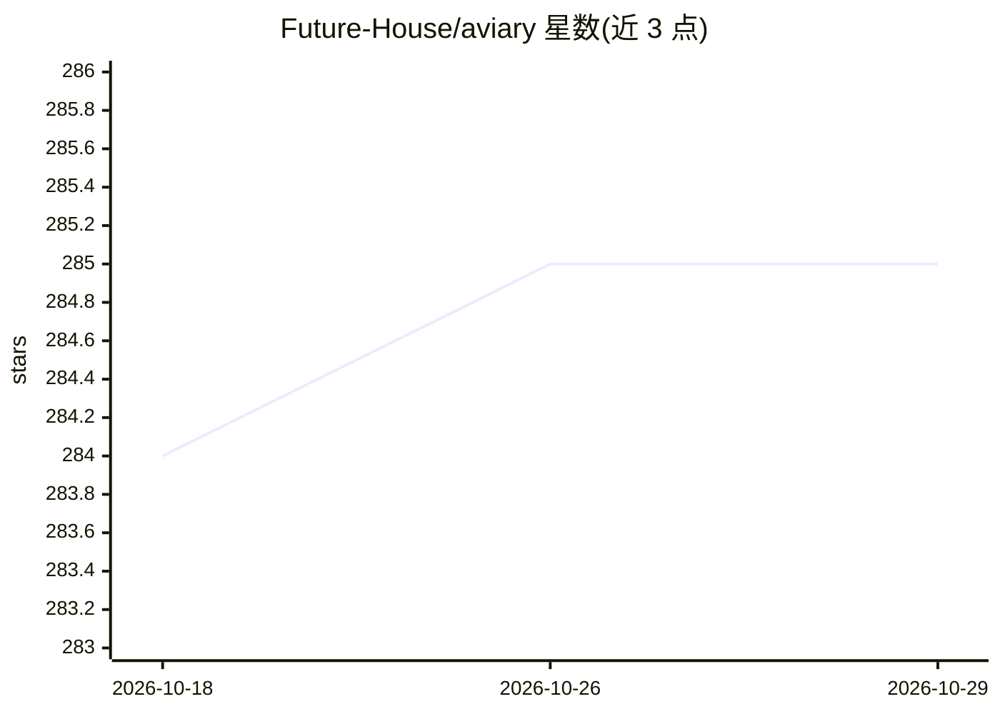

# Future-House/aviary

⭐ 285 · Python · Apache-2.0 · 推送 2026-10-27 · [GitHub](https://github.com/Future-House/aviary) · [官网](https://futurehouse.gitbook.io/futurehouse-cookbook/aviary) · 组织维护

**语言智能体强化学习环境库：科学任务的 gymnasium**

Future-House 维护的 Python 库，为语言智能体提供 gymnasium 式的自定义 RL 环境定义框架，含 reset/step 消息接口与工具调用机制。内置 GSM8K 数学、HotPotQA 常识问答、LAB-Bench、LFRQA 文献检索、蛋白质稳定性及 Notebook 六类环境，并附 TaskDataset 数据集。设计上与姊妹库 LDP 配合，用于将语言智能体建模为语言决策过程并训练评测；提供教程笔记本与工具查看服务器。以 pip 安装，各环境为可选 extras。

## 筛选速览

| 维度 | 判定 | 备注 |
|---|---|---|
| AI 角色 | `ai-ecosystem` | LLM/agent 周边工具 |
| 许可风险 | `permissive` | Apache-2.0 |
| 部署形态 | `library` | 以包/库形式分发 |
| 模型依赖 | — | README 未给出锁定关系 |
| 硬件要求 | — | 无带数字的原话,不猜 |
| 安装摩擦 | `low` | 无编译、无系统依赖或容器化 |
| 成熟度 | — | 结构信号不足 |

## 能力要点

- gymnasium 式自定义语言智能体 RL 环境框架（reset/step + 工具调用消息）
- 内置 GSM8K/HotPotQA/LAB-Bench/LFRQA/蛋白质稳定性/Notebook 六类科学任务环境
- 与 LDP 库配合将智能体建模为语言决策过程进行训练与评测
- 函数式装饰器接口与 aviary tools 服务器查看环境工具

## 适用场景

- 为语言智能体定义带工具调用的自定义 RL 训练环境
- 在 GSM8K、文献检索等科学任务上训练与评测语言智能体
- 复用内置 TaskDataset 做智能体基准评测

## 场景标签

`强化学习` `模型评测` · 领域:评测与运维

## 证据(README 行号)

> L17: **Aviary** [^1] is a gymnasium for defining custom language agent RL environments.
> L20: Aviary is designed to work in tandem with its sister library LDP (<https://github.com/Future-House/ldp>)
> L90: Aviary's sister library LDP (<https://github.com/Future-House/ldp>).

## 星数曲线

2026-10-18 284 → 2026-10-29 285（+1）

---
*卡片 v1 · prompt 1.4 · 生成 2026-10-22 · 置信度 high · 依据 README sha `1edd428ea401` · [字段定义](../../DATASET.md)*
