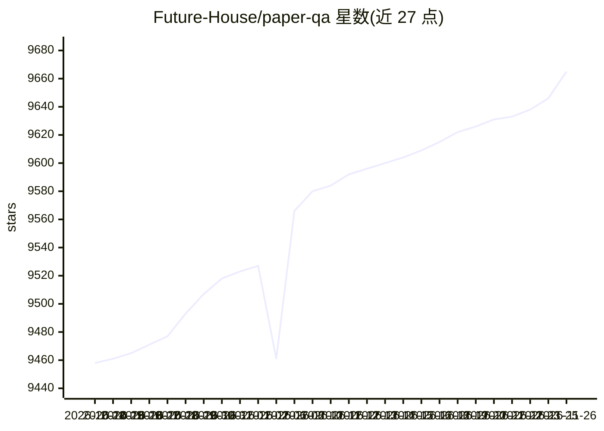

# Future-House/paper-qa

⭐ 9,665 · Python · Apache-2.0 · 推送 2026-11-16 · [GitHub](https://github.com/Future-House/paper-qa) · [官网](https://futurehouse.gitbook.io/futurehouse-cookbook) · 组织维护

**面向科研文献的 RAG 问答库：对 PDF 生成带引用的回答**

一个对 PDF、文本、Office 文档与源码做检索增强生成的 Python 包与 CLI（pqa），聚焦科学文献。工作流分三阶段：LLM 生成关键词检索候选论文并分块嵌入、对片段做打分摘要与重排序、最后生成带文内引用的回答；语言 agent 可迭代调用搜索/取证/回答工具。默认使用 OpenAI 嵌入与 Numpy 向量库，经 LiteLLM 兼容多家模型；大规模索引建议配置 Crossref 与 Semantic Scholar API key。要求 Python 3.11+。

## 筛选速览

| 维度 | 判定 | 备注 |
|---|---|---|
| AI 角色 | `ai-native` | 本体是模型或模型工具 |
| 许可风险 | `permissive` | Apache-2.0 |
| 部署形态 | `library` | 以包/库形式分发 |
| 模型依赖 | local-ok | 支持本地模型 |
| 硬件要求 | — | 无带数字的原话,不猜 |
| 安装摩擦 | `low` | 无编译、无系统依赖或容器化 |
| 成熟度 | — | 结构信号不足 |

## 能力要点

- 带文内引用的接地回答，答案附页码级出处
- agentic RAG：语言 agent 迭代调用论文搜索、取证、回答工具
- 经 LiteLLM 兼容多家模型，支持本地开源模型服务器
- 本地 PDF 全文检索引擎与可保存/复用的设置（pqa -s）

## 适用场景

- 对本地论文文件夹提问并获得带引用的回答
- 检测文献中的矛盾陈述或做文献综述摘要
- 大规模论文库的全文检索与索引管理

## 场景标签

`RAG` `科研工具` · 领域:知识与检索

## 证据(README 行号)

> L9: PaperQA2 is a package for doing high-accuracy retrieval augmented generation (RAG) on PDFs, text files, Microsoft Of
> L24: and finally answer the user question with an LLM agent.
> L63: - Support for agentic RAG, where a language agent can iteratively refine queries and answers.

## 星数曲线

2026-10-24 9,458 → 2026-11-26 9,665（+207）

---
*卡片 v1 · prompt 1.4 · 生成 2026-11-22 · 置信度 high · 依据 README sha `3e557ce9cbbb` · [字段定义](../../DATASET.md)*
