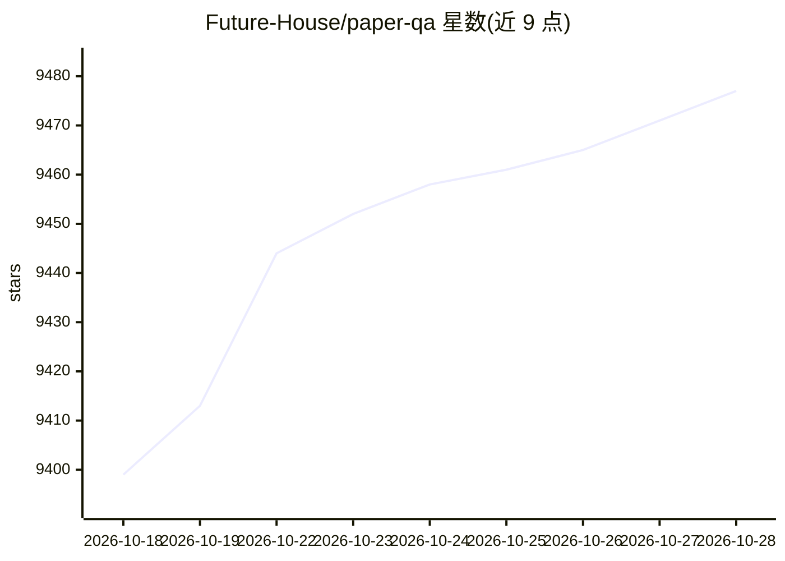

# Future-House/paper-qa

⭐ 9,493 · Python · Apache-2.0 · 推送 2026-10-26 · [GitHub](https://github.com/Future-House/paper-qa) · [官网](https://futurehouse.gitbook.io/futurehouse-cookbook) · 组织维护

**面向科学文献的高精度 RAG 问答工具，带引用溯源**

PaperQA2 是针对 PDF、文本、Office 文档与源码文件做检索增强生成（RAG）的 Python 包，聚焦科学文献场景。工作流为三阶段：论文检索（LLM 生成关键词查询）、证据收集（向量排序＋LLM 重打分与上下文摘要）、答案生成，答案内嵌引文标注。默认使用 OpenAI 嵌入与模型、Numpy 向量库，通过 LiteLLM 支持任意兼容模型，亦可接入开源 LLM 服务器。自动从 Semantic Scholar、Crossref 等获取文献元数据与引用数、撤稿检查。提供 pqa CLI 与配置模板；需 Python 3.11+，运行需 LLM API key 或本地 LLM 服务。

## 筛选速览

| 维度 | 判定 | 备注 |
|---|---|---|
| AI 角色 | `ai-native` | 本体是模型或模型工具 |
| 许可风险 | `permissive` | Apache-2.0 |
| 部署形态 | `library` | 以包/库形式分发 |
| 模型依赖 | local-ok | 支持本地模型 |
| 硬件要求 | — | 无带数字的原话,不猜 |
| 安装摩擦 | `low` | 无编译、无系统依赖或容器化 |
| 成熟度 | — | 结构信号不足 |

## 能力要点

- 三阶段 agentic RAG 工作流（检索→证据收集→生成），答案带文内引文
- 通过 LiteLLM 兼容多家 LLM 提供商，默认 OpenAI 嵌入＋Numpy 向量库
- 自动抓取文献元数据，含引用数与撤稿检查（Semantic Scholar/Crossref 等）
- 提供 pqa CLI、本地全文索引与可保存的配置模板

## 适用场景

- 对本地文件夹中的科研论文 PDF 提问并获得带引用的回答
- 科研人员做文献综述式问答、摘要与矛盾检测
- 对大量论文建全文索引后做检索式提问

## 场景标签

`RAG` `科研工具` · 领域:知识与检索

## 证据(README 行号)

> L9: PaperQA2 is a package for doing high-accuracy retrieval augmented generation (RAG) on PDFs, text files, Microsoft Of
> L60: - A simple interface to get good answers with grounded responses containing in-text citations.

## 星数曲线

2026-10-18 9,399 → 2026-10-28 9,477（+78）

---
*卡片 v1 · prompt 1.4 · 生成 2026-10-20 · 置信度 high · 依据 README sha `9f3ff506bf0d` · [字段定义](../../DATASET.md)*
