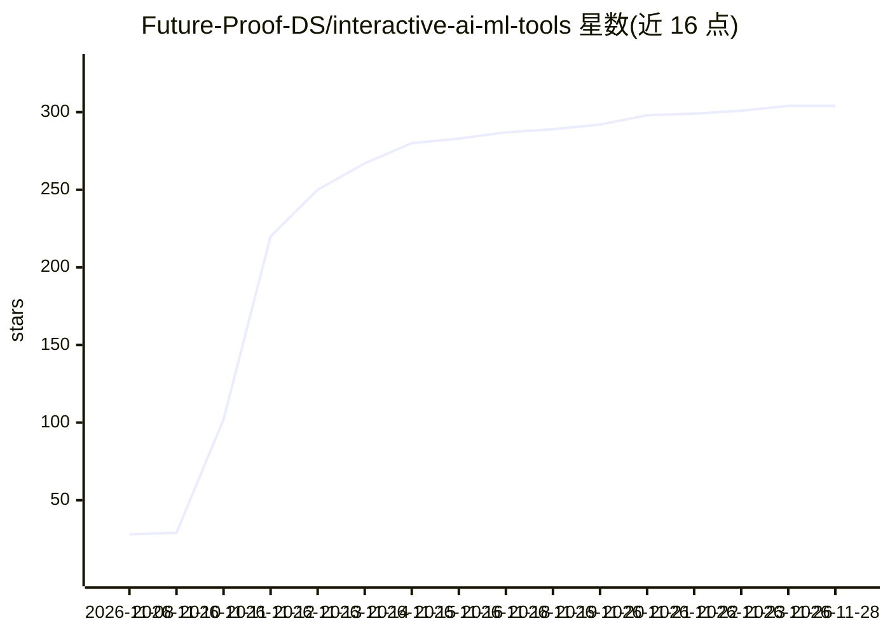

# Future-Proof-DS/interactive-ai-ml-tools

⭐ 304 · 推送 2026-11-02 · [GitHub](https://github.com/Future-Proof-DS/interactive-ai-ml-tools) · [官网](https://futureproofds.com/tools?utm_source=github&utm_medium=readme&utm_campaign=andres_vourakis_github&utm_content=interactive_tools) · 个人维护

**面向数据科学家的交互式 MLOps/ML 系统设计/agentic 分析学习工具集**

一套免费浏览器交互式学习工具，覆盖生产 ML 系统解剖（训练、实验跟踪、CI/CD、模型服务、漂移监控）、ML 项目结构、数据漂移模拟、text-to-SQL agentic 分析系统组成与 AI 评测五件工具，按 ML in production 与 agentic analytics 两条路径组织。用户直接在浏览器点击浏览系统组件、跟随场景推演，无需本地安装或编译。由 Andres Vourakis 创建，托管于 Future Proof Data Science 站点。工具声明不替代动手实践，定位为理论学习与直觉建立。

## 筛选速览

| 维度 | 判定 | 备注 |
|---|---|---|
| AI 角色 | `ai-knowledge` | 知识聚合/清单类 |
| 许可风险 | `none` | — |
| 部署形态 | `None` |  |
| 模型依赖 | — | README 未给出锁定关系 |
| 硬件要求 | — | 无带数字的原话,不猜 |
| 安装摩擦 | `low` | 无编译、无系统依赖或容器化 |
| 成熟度 | — | 结构信号不足 |

## 能力要点

- 五个交互式工具：生产 ML 系统解剖、ML 项目结构、数据漂移模拟、agentic 分析系统图、AI 评测步骤
- 浏览器即开即用，无需安装
- 按 ML in production / agentic analytics 两条学习路径组织
- 数据漂移模拟覆盖已部署模型六个月的场景

## 适用场景

- 系统学习 MLOps 与 ML 系统设计的完整组成
- 理解 text-to-SQL agent 系统结构与 AI 评测方法
- 通过交互场景理解数据漂移的产生与监测

## 场景标签

`教程课程` · 领域:学习与行业

## 证据(README 行号)

> L3: Free, interactive tools for learning MLOps, ML system design and agentic analytics.
> L9: Interactive AI and ML tools for data scientists: Anatomy of a Production ML System, ML Project Structure, Data Drift

## 星数曲线

2026-11-08 28 → 2026-11-28 304（+276）

---
*卡片 v1 · prompt 1.4 · 生成 2026-11-17 · 置信度 high · 依据 README sha `26542827725c` · [字段定义](../../DATASET.md)*
