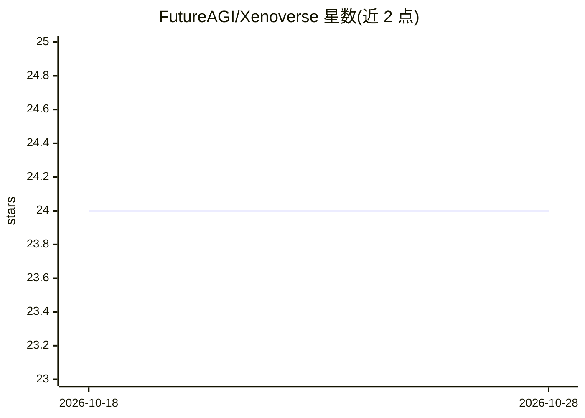

# FutureAGI/Xenoverse

⭐ 24 · Python · Apache-2.0 · 推送 2026-10-11 · [GitHub](https://github.com/FutureAGI/Xenoverse) · [官网](https://futureagi.github.io/) · 组织维护 · 中文 README

**通用决策能力评测环境集合：随机世界基准生成**

由 FutureAGI 维护的 Python 包，汇集 8 类程序化生成的环境族（随机 MDP/POMDP、线性系统控制、HVAC 控制、合成语言、3D 迷宫导航、随机控制、化学 agent 世界、城镇 agent 工作区），用于评测通用决策、上下文适应与元训练。环境共享单一命名空间与相似的任务采样流程，兼容 Gymnasium API（gym.make 使用）。定位面向元强化学习、上下文强化学习与开放世界评测研究。

## 筛选速览

| 维度 | 判定 | 备注 |
|---|---|---|
| AI 角色 | `ai-ecosystem` | LLM/agent 周边工具 |
| 许可风险 | `permissive` | Apache-2.0 |
| 部署形态 | `library` | 以包/库形式分发 |
| 模型依赖 | — | README 未给出锁定关系 |
| 硬件要求 | — | 无带数字的原话,不猜 |
| 安装摩擦 | `low` | 无编译、无系统依赖或容器化 |
| 成熟度 | — | 结构信号不足 |

## 能力要点

- 8 个环境族：anymdp/linds/anyhvac/metalang/mazeworld/metacontrol/chemverse/ai_town_env
- 多世界生成过程评测，任务采样流程跨族复用
- 兼容 Gymnasium API，pip 即装即用
- chemverse 提供工具交互式化学世界与路线打分

## 适用场景

- 元强化学习/上下文强化学习的训练与评测
- 跨随机任务分布检验 agent 泛化与上下文适应能力
- 化学 agent 的程序化任务生成与评分

## 场景标签

`模型评测` `强化学习` · 领域:评测与运维

## 证据(README 行号)

> L5: Xenoverse is a collection of procedurally generated environments for benchmarking general decision-making, in-contex
> L98: - meta-reinforcement learning
> L99: - in-context reinforcement learning

## 星数曲线

2026-10-18 24 → 2026-10-28 24（+0）

---
*卡片 v1 · prompt 1.4 · 生成 2026-10-27 · 置信度 high · 依据 README sha `08ba44d0c4ae` · [字段定义](../../DATASET.md)*
