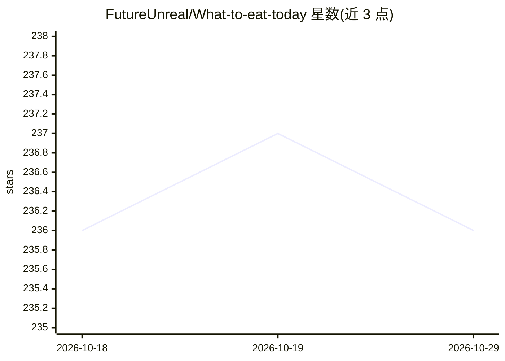

# FutureUnreal/What-to-eat-today

⭐ 236 · Python · MIT · 推送 2026-02-06 · [GitHub](https://github.com/FutureUnreal/What-to-eat-today) · [官网](https://datawhalechina.github.io/all-in-rag/) · 个人维护 · 中文 README

**给美食选择困难者的图RAG烹饪推荐与指导助手**

基于 Datawhale/all-in-rag 教程的实战案例项目：以 HowToCook 菜谱数据构建知识图谱（Neo4j）与向量索引（Milvus），通过图RAG+向量混合检索生成个性化美食推荐和分步骤烹饪指导，前端为 Next.js 14 对话界面，后端为 Python Flask。用户通过 Docker Compose 一键启动全栈服务（含 Nginx 反向代理），菜谱数据来自开源项目 HowToCook。

## 筛选速览

| 维度 | 判定 | 备注 |
|---|---|---|
| AI 角色 | `ai-native` | 本体是模型或模型工具 |
| 许可风险 | `permissive` | MIT |
| 部署形态 | `self-host` | docker 或自建部署 |
| 模型依赖 | — | README 未给出锁定关系 |
| 硬件要求 | — | 无带数字的原话,不猜 |
| 安装摩擦 | `low` | 无编译、无系统依赖或容器化 |
| 成熟度 | — | 结构信号不足 |

## 能力要点

- 图RAG + 向量检索的双重AI推荐
- Neo4j 图数据库与 Milvus 向量数据库混合检索
- Docker Compose 一键启动全栈（前端/后端/数据库/Nginx）
- 菜谱数据来源于 HowToCook 开源项目

## 适用场景

- 不知道吃什么时通过对话获得个性化美食推荐
- 获取分步骤的烹饪指导
- 学习图RAG技术在实际场景中的实现

## 场景标签

`聊天机器人` `教程课程` · 领域:对话与助手

## 证据(README 行号)

> L3: 本项目是基于 Datawhale/all-in-rag 教程的完整实战案例，展示了如何使用图RAG技术构建智能烹饪助手，为您推荐个性化美食和详细烹饪指导。
> L9: - 🤖 **智能推荐**: 基于图RAG + 向量检索的双重AI推荐
> L83: - Milvus (向量数据库)

## 星数曲线

2026-10-18 236 → 2026-10-29 236（+0）

---
*卡片 v1 · prompt 1.4 · 生成 2026-10-22 · 置信度 high · 依据 README sha `9d37bab07de2` · [字段定义](../../DATASET.md)*
