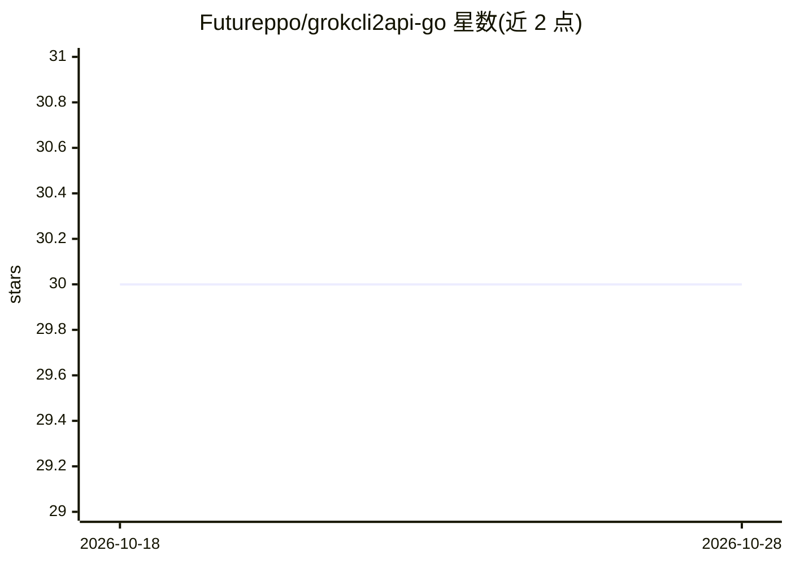

# Futureppo/grokcli2api-go

⭐ 30 · Go · AGPL-3.0 · 推送 2026-08-01 · [GitHub](https://github.com/Futureppo/grokcli2api-go) · 个人维护 · 中文 README

**将 Grok CLI 上游转为 OpenAI/Anthropic 兼容 API 的 Go 网关**

Go 编写的非官方 API 兼容服务：把 Grok CLI 使用的上游接口转换为 OpenAI Chat Completions、OpenAI Responses 与 Anthropic Messages 格式，现有应用通常只需改 API Base URL 即可接入。运行时仅依赖 Go 标准库，提供多账号/多 scope OAuth 凭证池、自动刷新、账号级模型发现与动态 backend 路由、会话亲和、失败重试与容量背压。支持 Docker Compose、预构建镜像、一键部署脚本与源码运行。README 声明与 xAI、OpenAI、Anthropic 无关联，使用非公开上游接口存在兼容性与账号风险。

## 筛选速览

| 维度 | 判定 | 备注 |
|---|---|---|
| AI 角色 | `ai-ecosystem` | LLM/agent 周边工具 |
| 许可风险 | `viral` | AGPL-3.0 |
| 部署形态 | `self-host` | docker 或自建部署 |
| 模型依赖 | locked-api |  |
| 硬件要求 | — | 无带数字的原话,不猜 |
| 安装摩擦 | `low` | 无编译、无系统依赖或容器化 |
| 成熟度 | — | 结构信号不足 |

## 能力要点

- OpenAI Chat Completions / Responses 与 Anthropic Messages 三协议对外接口，流式 SSE 与非流式
- 多账号凭证池、OIDC 自动刷新、按账号模型能力动态路由与失败重试
- 账号级并发上限、容量背压与 429/额度冷却调度
- 单一二进制、Docker 多阶段构建与一键部署脚本

## 适用场景

- 让现有 OpenAI/Anthropic SDK 应用直接调用 Grok CLI 上游
- 通过多账号凭证池提高可用性并管理额度冷却
- 在 New API 等 API 聚合项目中作为上游接入

## 场景标签

`模型网关` · 领域:Agent 开发

## 证据(README 行号)

> L16: `grokcli2api-go` 是一个使用 Go 编写的非官方 API 兼容服务。它将 Grok CLI 使用的上游接口转换为 OpenAI Chat Completions、OpenAI Responses 与 Anthrop
> L18: 项目运行时仅依赖 Go 标准库，提供多账号/多 scope 凭证池、自动刷新、账号级模型发现与动态 backend 路由、会话连续性、失败重试和容量背压等能力，适合本地开发、内网服务和容器化部署。

## 星数曲线

2026-10-18 30 → 2026-10-28 30（+0）

---
*卡片 v1 · prompt 1.4 · 生成 2026-10-26 · 置信度 high · 依据 README sha `c8bac2d44c8a` · [字段定义](../../DATASET.md)*
