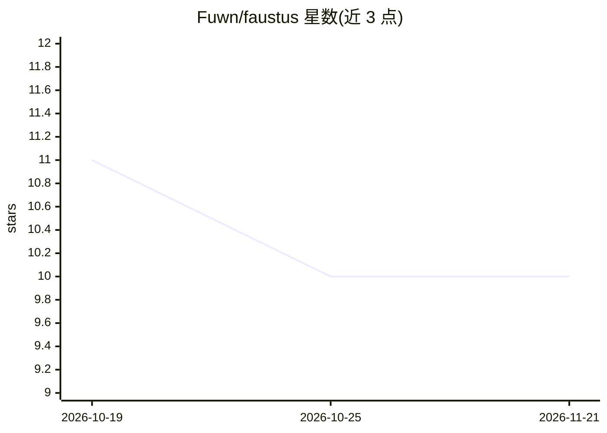

# Fuwn/faustus

⭐ 10 · Go · Apache-2.0 · 推送 2026-02-27 · [GitHub](https://github.com/Fuwn/faustus) · 个人维护

**管理 Claude Code 会话的终端 TUI 工具**

基于 Bubbletea 的终端界面工具，用于管理本地 Claude Code 会话：浏览会话列表、按摘要/提示词/项目名过滤、跨全部会话内容做深度搜索、带高亮的预览窗格，并支持删除入回收站、恢复、重命名摘要、项目文件夹迁移后的路径重指向与清空回收站。会话数据读取自 ~/.claude/projects/，删除的会话移入 ~/.claude/faustus-trash/ 以支持恢复。提供 go install、Nix run 与源码构建三种安装方式，操作采用 Vim 风格键位。

## 筛选速览

| 维度 | 判定 | 备注 |
|---|---|---|
| AI 角色 | `ai-ecosystem` | LLM/agent 周边工具 |
| 许可风险 | `permissive` | Apache-2.0 |
| 部署形态 | `library` | 以包/库形式分发 |
| 模型依赖 | — | README 未给出锁定关系 |
| 硬件要求 | — | 无带数字的原话,不猜 |
| 安装摩擦 | `low` | 无编译、无系统依赖或容器化 |
| 成熟度 | — | 结构信号不足 |

## 能力要点

- 跨所有会话内容（消息、代码等）的深度搜索并显示上下文
- 回收站机制：删除可恢复，支持清空永久删除
- 项目文件夹迁移后批量重新指向会话路径
- Vim 风格键位的列表/预览双焦点交互

## 适用场景

- 查找散落在本地的 Claude Code 历史会话内容
- 清理或整理大量 Claude Code 会话记录
- 项目目录移动后修复会话的文件夹指向

## 场景标签

 · 领域:开发者工具/终端应用

## 证据(README 行号)

> L3: > A beautiful TUI for managing Claude Code sessions
> L9: - **Browse Sessions**: View all your Claude Code conversation sessions
> L77: Sessions are stored in `~/.claude/projects/`. Binned sessions are moved to `~/.claude/faustus-trash/`.

## 星数曲线

2026-10-19 11 → 2026-11-21 10（-1）

---
*卡片 v1 · prompt 1.4 · 生成 2026-11-20 · 置信度 high · 依据 README sha `51fe798e7772` · [字段定义](../../DATASET.md)*
