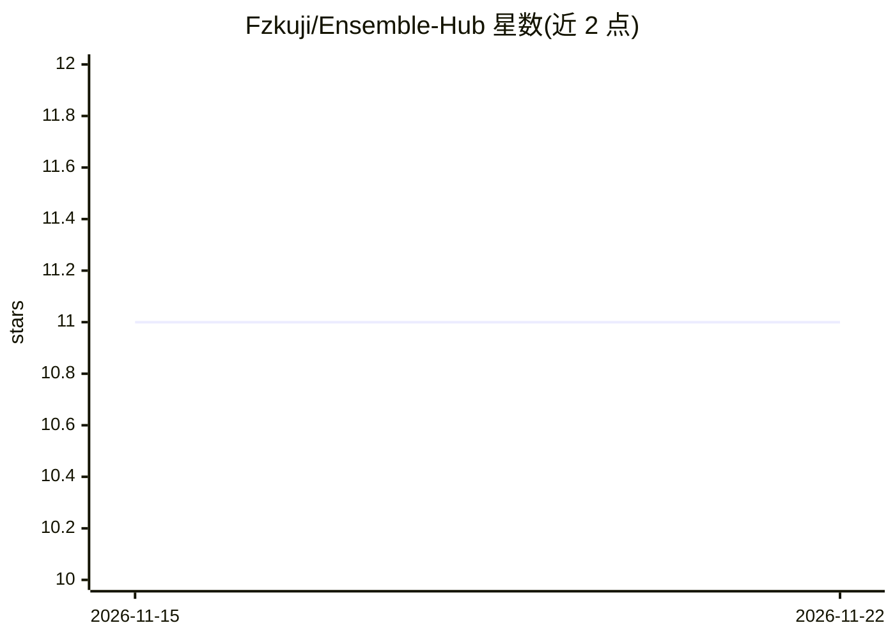

# Fzkuji/Ensemble-Hub

⭐ 11 · Python · GPL-3.0 · 推送 2026-04-14 · [GitHub](https://github.com/Fzkuji/Ensemble-Hub) · 组织维护 · 中文 README

**大小模型协同推理框架与 LLM 集成推理工具包**

ACL 2025 Findings 论文 Tandem 的官方实现：LLM 生成少量关键推理洞见（GPRA 模式），由成本感知终止分类器判断充分性后，SLM 接管完成推理并输出答案；论文报告在数学推理与代码生成基准上相较单独 LLM 推理降低约 40% 计算成本。仓库另含 Ensemble-Hub 工具包，支持多种模型选择与输出聚合策略、批量推理，并提供 OpenAI 兼容的 FastAPI 服务与 lm-evaluation-harness 兼容评测。

## 筛选速览

| 维度 | 判定 | 备注 |
|---|---|---|
| AI 角色 | `ai-ecosystem` | LLM/agent 周边工具 |
| 许可风险 | `viral` | GPL-3.0 |
| 部署形态 | `library` | 以包/库形式分发 |
| 模型依赖 | locked-api |  |
| 硬件要求 | — | 无带数字的原话,不猜 |
| 安装摩擦 | `low` | 无编译、无系统依赖或容器化 |
| 成熟度 | — | 结构信号不足 |

## 能力要点

- mentor-intern 协作：LLM 出洞见、SLM 完成推理
- 成本感知终止机制，按问题难度自适应分配算力
- 支持 6 种输出聚合策略与 3 种模型选择策略
- 提供 OpenAI 兼容 FastAPI 服务与批量推理入口

## 适用场景

- 复现 Tandem 在 MATH-500/HumanEval 上的实验
- 用大小模型组合降低推理计算成本
- 以 OpenAI 兼容接口提供多模型集成推理
- 配合 lm-evaluation-harness 做标准化评测

## 场景标签

`模型评测` `推理引擎` · 领域:评测与运维

## 证据(README 行号)

> L84: Beyond Tandem, this repository also provides a general-purpose **LLM ensemble inference toolkit** supporting multip
> L114: Compatible with lm-evaluation-harness for standardized benchmarking.

## 星数曲线

2026-11-15 11 → 2026-11-22 11（+0）

---
*卡片 v1 · prompt 1.4 · 生成 2026-11-19 · 置信度 high · 依据 README sha `7d3f3e2842e3` · [字段定义](../../DATASET.md)*
