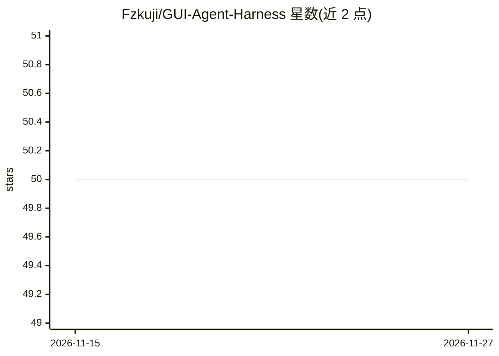

# Fzkuji/GUI-Agent-Harness

⭐ 50 · Python · MIT · 推送 2026-09-13 · [GitHub](https://github.com/Fzkuji/GUI-Agent-Harness) · [官网](https://openprogram.io/docs/capabilities/workflows/gui-agent.html) · 个人维护 · 中文 README

**给开发者的自主 GUI 自动化 agent：用自然语言驱动桌面操作**

CLI 工具，将 LLM 转为 GUI 自动化 agent：接收自然语言任务后自主截图、点击、输入、验证，循环执行直到完成。核心机制包括迭代缩放的元素定位管线（YOLO 检测 + OCR + 模板匹配，逐级裁剪放大并由验证器把关坐标）、四阶段 agent 循环（观察→验证→规划→调度），以及将已识别 UI 组件存为模板的视觉记忆（后续以模板匹配替代重检测）。构建于 OpenProgram 运行时之上，支持任意 LLM provider，可操作本地桌面或 VM，主要面向 macOS，Windows/Linux 亦可安装。

## 筛选速览

| 维度 | 判定 | 备注 |
|---|---|---|
| AI 角色 | `ai-native` | 本体是模型或模型工具 |
| 许可风险 | `permissive` | MIT |
| 部署形态 | `None` |  |
| 模型依赖 | — | README 未给出锁定关系 |
| 硬件要求 | — | 无带数字的原话,不猜 |
| 安装摩擦 | `medium` | 含编译或系统依赖之一 |
| 成熟度 | — | 结构信号不足 |

## 能力要点

- 迭代缩放定位管线：YOLO + OCR + 模板匹配，多轮裁剪放大并带验证器门控
- 视觉记忆：组件一次检测后存为模板，重遇时以模板匹配替代重检测
- 四阶段 agent 循环：观察（截图+检测）→ 验证 → 规划 → 调度执行
- 跨平台安装器：macOS 用 Apple Vision OCR，Windows/Linux 用 EasyOCR，自动检测 NVIDIA GPU

## 适用场景

- 用自然语言让 agent 自动完成桌面上的多步操作任务
- 在 VM 中远程执行 GUI 自动化（浏览器操作等）
- 复用其 grounding 管线做 GUI 元素定位与基准评测

## 场景标签

`GUI 自动化` · 领域:效率与自动化

## 证据(README 行号)

> L26: A CLI tool that turns any LLM into a GUI automation agent. Give it a natural-language task, it operates the desktop
> L33: Built on OpenProgram — the runtime handles provider abstraction, context management, and structured LLM calls. The 

## 星数曲线

2026-11-15 50 → 2026-11-27 50（+0）

---
*卡片 v1 · prompt 1.4 · 生成 2026-11-18 · 置信度 high · 依据 README sha `ef759ac72753` · [字段定义](../../DATASET.md)*
