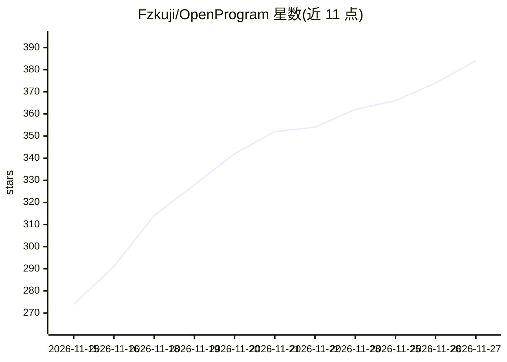

# Fzkuji/OpenProgram

⭐ 384 · Python · AGPL-3.0 · 推送 2026-11-25 · [GitHub](https://github.com/Fzkuji/OpenProgram) · [官网](https://fzkuji.github.io/OpenProgram/) · 个人维护 · 中文 README

**开源 agent harness：用 Python 编写可自我编程的 LLM 智能体**

一个以 Python 程序形式编写 agent 的 harness：分支、重试与校验是普通代码，self(...) 触发模型调用；agent 可向自身类写入新方法作为下一轮可调用工具。每次模型/函数调用是可检查、分支与回放的图节点，子 agent 在独立分支工作。提供桌面 App、Web UI、终端 UI 与 CLI 四种形态，支持定时任务、后台操作计算机及 Telegram/Discord/Slack/WeChat 接入，声称接入 300+ 提供商与本地模型。AGPL-3.0 许可。

## 筛选速览

| 维度 | 判定 | 备注 |
|---|---|---|
| AI 角色 | `ai-ecosystem` | LLM/agent 周边工具 |
| 许可风险 | `viral` | AGPL-3.0 |
| 部署形态 | `None` |  |
| 模型依赖 | — | README 未给出锁定关系 |
| 硬件要求 | — | 无带数字的原话,不猜 |
| 安装摩擦 | `low` | 无编译、无系统依赖或容器化 |
| 成熟度 | `idea` | |

## 能力要点

- Agent 即 Python 程序，self(...) 为模型调用入口
- agent 可向自身写入新方法并转为可调用工具
- 每次调用构成可检查、分支、回放的图结构
- 桌面 App / Web / TUI / CLI 四种运行形态

## 适用场景

- 用 Python 编写带分支重试的 LLM 工作流与应用
- 让 agent 定时任务化并常驻运行目标
- 通过 Telegram/Slack 等聊天工具远程驱动 agent

## 场景标签

`Agent 框架` `多智能体` `工作流自动化` · 领域:Agent 开发

## 证据(README 行号)

> L3:  Agents program anything. Workflows, apps with AI inside, and the agents themselves. An open-source agent harness wh
> L47:  Agents are Python programs Branches, retries and checks are ordinary code; <code>self(...)</code> is a model call.
> L54:  Any model 300+ providers and local models; several keys per provider, switched automatically at a limit.

## 星数曲线

2026-11-15 274 → 2026-11-27 384（+110）

---
*卡片 v1 · prompt 1.4 · 生成 2026-11-26 · 置信度 high · 依据 README sha `557f4272ecea` · [字段定义](../../DATASET.md)*
