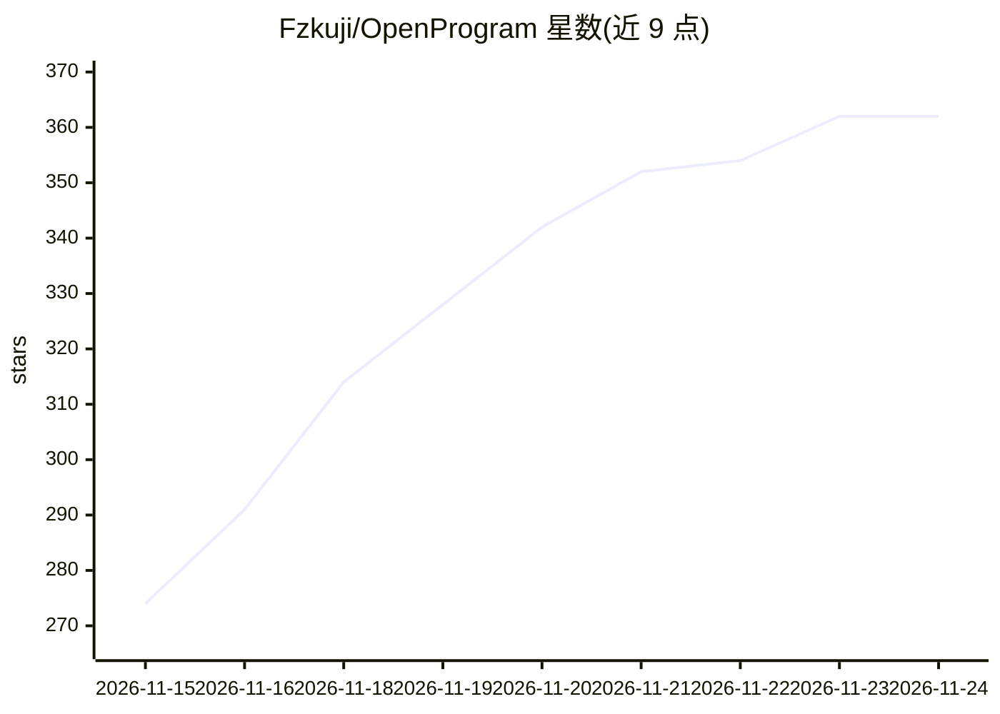

# Fzkuji/OpenProgram

⭐ 362 · Python · AGPL-3.0 · 推送 2026-11-17 · [GitHub](https://github.com/Fzkuji/OpenProgram) · [官网](https://openprogram.io/) · 组织维护 · 中文 README

**开源 agent 框架：以会自我修改的 Python 程序构建 agent**

Agent 编排框架与工作区的组合：agent 定义为 Python 类，分支、重试与校验用代码表达，self(...) 即模型调用；agent 可向自身类写入新方法，下一轮即成为工具。执行以 DAG 节点记录，可检查、分支与重放；上下文按节点选择读取并自动压缩。提供桌面/网页工作区、内置浏览器、终端、computer use、权限审批与沙箱、MCP 接入以及 Telegram/Discord/Slack/WeChat 渠道。支持多 provider（Anthropic/OpenAI/Gemini 等）与本地推理服务器。AGPL-3.0 许可。

## 筛选速览

| 维度 | 判定 | 备注 |
|---|---|---|
| AI 角色 | `ai-ecosystem` | LLM/agent 周边工具 |
| 许可风险 | `viral` | AGPL-3.0 |
| 部署形态 | `desktop` | 安装包/桌面程序 |
| 模型依赖 | — | README 未给出锁定关系 |
| 硬件要求 | — | 无带数字的原话,不猜 |
| 安装摩擦 | `low` | 无编译、无系统依赖或容器化 |
| 成熟度 | — | 结构信号不足 |

## 能力要点

- agent 为 Python 类，self-programming 使新方法成为下轮可用工具
- 每次用户轮次/模型调用/函数调用均为 DAG 节点，可分支与重放
- 桌面与网页工作区：分栏、内置浏览器、集成终端、computer use
- 权限审批、沙箱执行与 MCP 双向支持

## 适用场景

- 用 Python 代码编写带校验与重试的 agent
- 在统一工作区中让 agent 操作浏览器、终端与桌面应用
- 通过 Telegram/Discord/Slack/WeChat 与自有 agent 对话

## 场景标签

`Agent 框架` `GUI 自动化` `浏览器自动化` · 领域:Agent 开发

## 证据(README 行号)

> L3:  An open-source agent harness where agents are Python programs that improve themselves.
> L58: |**Agent classes**|An agent is a Python class; branches, retries and checks are code, `self(...)` is a model call.|
> L61: |**Self-programming**|Agents write new methods into their own class; they become tools on the next turn.|

## 星数曲线

2026-11-15 274 → 2026-11-24 362（+88）

---
*卡片 v1 · prompt 1.4 · 生成 2026-11-17 · 置信度 high · 依据 README sha `f7c7e0f5f0d7` · [字段定义](../../DATASET.md)*
