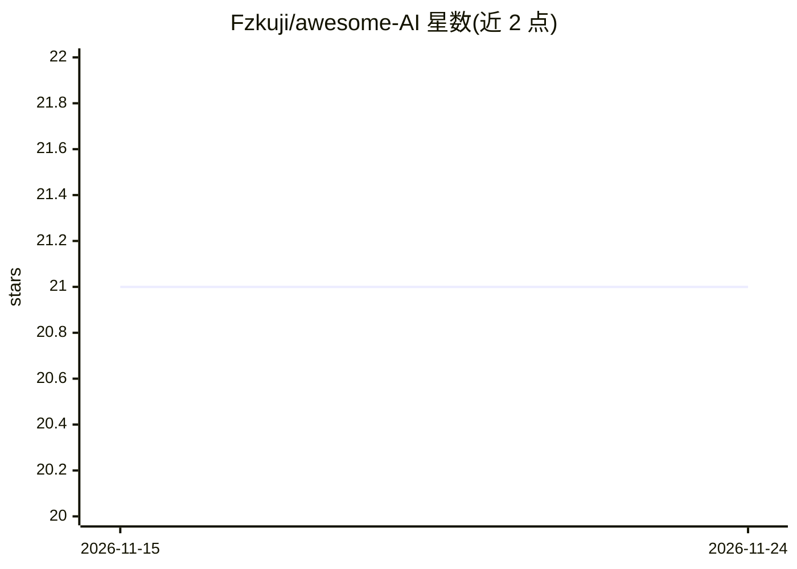

# Fzkuji/awesome-AI

⭐ 21 · 推送 2026-01-14 · [GitHub](https://github.com/Fzkuji/awesome-AI) · 个人维护 · 中文 README

**个人机器学习/AI 学习笔记仓库：系统整理 AI 概念、算法与应用**

由个人维护的人工智能学习笔记仓库，记录并组织作者所学机器学习知识，长期更新，近期主题包括 LLM 记忆、LLM 集成、知识编辑、LLM 融合、记忆 Transformer 等。目标是覆盖实现人类水平智能所需的各方面知识，面向任何想理解相关内容、基于自身知识水平阅读的读者，欢迎贡献笔记、外部站点与新技术提醒；部分内容来自互联网公开资料并附参考。同时收录深度学习教程与课程（动手学深度学习、李宏毅课程、UvA、NYU 等）作为延伸阅读。

## 筛选速览

| 维度 | 判定 | 备注 |
|---|---|---|
| AI 角色 | `ai-knowledge` | 知识聚合/清单类 |
| 许可风险 | `none` | — |
| 部署形态 | `None` |  |
| 模型依赖 | — | README 未给出锁定关系 |
| 硬件要求 | — | 无带数字的原话,不猜 |
| 安装摩擦 | `low` | 无编译、无系统依赖或容器化 |
| 成熟度 | — | 结构信号不足 |

## 能力要点

- 覆盖 LLM 记忆/集成/融合、知识编辑、记忆 Transformer 等主题的长期更新笔记
- 收录《动手学深度学习》、李宏毅课程、UvA DL Notebooks、NYU Deep Learning 等延伸教程
- 开放贡献：接受个人笔记、外部站点、视频与新技术提醒

## 适用场景

- 系统查找与学习机器学习各主题的中文/英文笔记
- 跟随 LLM 记忆、知识编辑等前沿主题的学习脉络
- 寻找配套的深度学习公开课与教程资源

## 场景标签

`教程课程` · 领域:学习与行业

## 证据(README 行号)

> L3: ✨ Welcome to my Artificial Intelligence Study Notes project! This project is my personal study notes, which records 
> L26: 👀 My goal is a machine with the same level of intelligence as a human. For this, I need knowledge in all aspects.

## 星数曲线

2026-11-15 21 → 2026-11-24 21（+0）

---
*卡片 v1 · prompt 1.4 · 生成 2026-11-18 · 置信度 high · 依据 README sha `d7313c6a2df8` · [字段定义](../../DATASET.md)*
