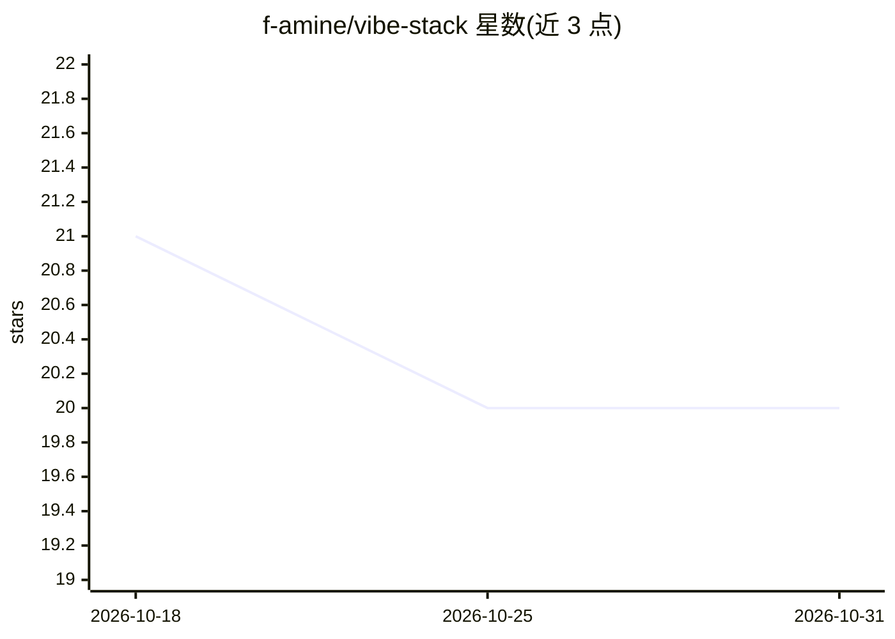

# f-amine/vibe-stack

⭐ 20 · TypeScript · MIT · 推送 2026-06-29 · [GitHub](https://github.com/f-amine/vibe-stack) · [官网](https://vibestack.salzier.com) · 个人维护

**面向 Claude Code 工作流的全栈 SaaS 启动模板**

一个预设好全部基础设施决策的 Next.js 16 全栈 SaaS 脚手架：包含 web/marketing/admin 三个应用、Better Auth 认证、Drizzle/Postgres、tRPC、Polar 计费、R2 存储、Dokploy 部署等预接线组件；仓库内置全套 Claude Code 技能（/tdd、/to-prd、/review 等），由 Claude Code 驱动从想法到 PR 的开发流程，并附可选的 24/7 自主 Claude swarm。支持零密钥启动，第三方集成为可选并渐进降级。README 明确不含应用级 AI 功能，定位为 AI 辅助开发模板而非 AI SaaS 模板。

## 筛选速览

| 维度 | 判定 | 备注 |
|---|---|---|
| AI 角色 | `ai-ecosystem` | LLM/agent 周边工具 |
| 许可风险 | `permissive` | MIT |
| 部署形态 | `library` | 以包/库形式分发 |
| 模型依赖 | locked-api |  |
| 硬件要求 | — | 无带数字的原话,不猜 |
| 安装摩擦 | `low` | 无编译、无系统依赖或容器化 |
| 成熟度 | — | 结构信号不足 |

## 能力要点

- 内置全套 Claude Code 技能（vendored，无需安装）驱动开发工作流
- 三应用全栈预接线：Next.js 16 / Better Auth / Drizzle / tRPC / Polar / R2
- 零密钥启动：仅数据库与 auth secret 即可运行，集成按需启用
- npx create-vibestack 向导完成命名、功能开关与 .env 生成

## 适用场景

- 开发者用它作为 SaaS 项目起点，自己补业务逻辑
- Vibe-coder 打开 Claude Code 描述想法，按技能工作流推进开发
- 通过 Dokploy + docker-compose 部署到 VPS 并获得夜间数据库备份

## 场景标签

 · 领域:软件开发/SaaS 模板

## 证据(README 行号)

> L7: An opinionated, AI-first SaaS starter. Full stack pre-wired, every infra decision pre-made, every Claude Code skill 
> L43: - **App-level AI features.** The stack is AI-native *dev*, not an AI SaaS template. Add the `ai` SDK or any model w
> L86: Open Claude Code in the repo. Skills come vendored, no install step:

## 星数曲线

2026-10-18 21 → 2026-10-31 20（-1）

---
*卡片 v1 · prompt 1.4 · 生成 2026-10-28 · 置信度 high · 依据 README sha `c89b587caaa1` · [字段定义](../../DATASET.md)*
