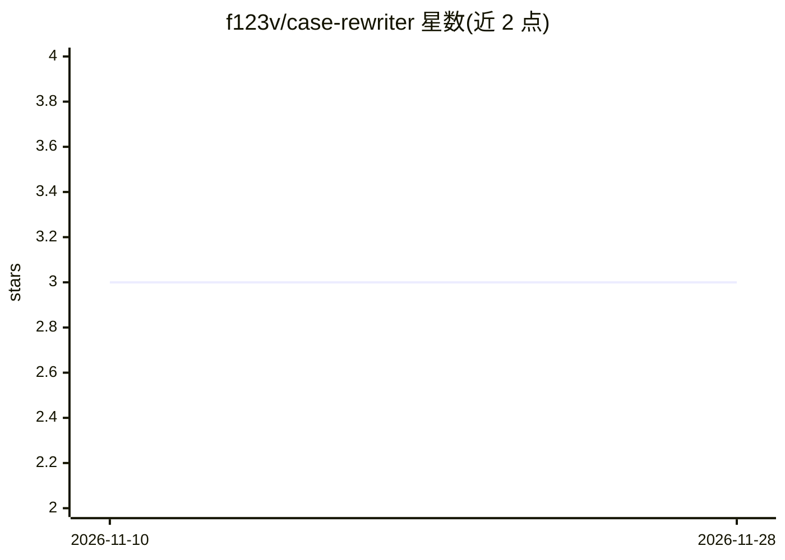

# f123v/case-rewriter

⭐ 3 · Python · MIT · 推送 2026-10-29 · [GitHub](https://github.com/f123v/case-rewriter) · 个人维护 · 中文 README

**给医学教学场景用的病例改写 Agent Skill 与校验脚本**

一个兼容 Claude Skills / 通用 Agent 技能目录格式的 Skill：读取原始病例与《病历书写要求》规范文件，按 SKILL.md 定义的工作流（抽规则→拆病例→列变量映射→逐项重建→跑校验）产出合规改写病例，附变更清单。核心机制是把人卫第八版《诊断学》大病历规范拆成 23 条可执行规则，配套零依赖 Python 脚本 spec_lint.py 做 11 类机检（章节顺序、淋巴结、神经反射、三线表数值等）。脚本可脱离 Agent 独立运行，需 Python 3.9+ 标准库。声明输出须经带教老师/执业医师审核，禁止用于伪造研究数据或篡改真实病历。

## 筛选速览

| 维度 | 判定 | 备注 |
|---|---|---|
| AI 角色 | `ai-native` | 本体是模型或模型工具 |
| 许可风险 | `permissive` | MIT |
| 部署形态 | `None` |  |
| 模型依赖 | — | README 未给出锁定关系 |
| 硬件要求 | — | 无带数字的原话,不猜 |
| 安装摩擦 | `low` | 无编译、无系统依赖或容器化 |
| 成熟度 | — | 结构信号不足 |

## 能力要点

- 《大病历书写要求》拆成 23 条可执行规则，含歧义确认表
- spec_lint.py 零依赖校验脚本，11 类违规有负向测试记录
- 附改写矩阵：限定人口学/时间轴/数值等字段的可改范围
- 附脱敏脚本 deid.py（脱敏+日期平移）与骨架生成脚本 scaffold.py

## 适用场景

- 医学院学生练习把原始病例改写成合规大病历
- OSCE/SP 教学脚本的病例素材改写与脱敏
- 科室替换自有规范文件后做结构化归档校验

## 场景标签

`AI 写作` · 领域:内容生成

## 证据(README 行号)

> L10: 一个给 AI Agent 用的 Skill（兼容 Claude Skills / 通用 Agent 技能目录格式）。核心不是"换个说法"，而是**把规范文件编译成检查项**，再用脚本把"改写后不合规"这件事拦住。
> L59: 已把《大病历书写要求》（人卫第八版《诊断学》格式）拆成 23 条可执行规则：`references/specs/dabingli.md`
> L121: 装好后对 Agent 说：**"按这份要求把病例改成大病历"**（附上规范 PDF 和病例），即可触发。

## 星数曲线

2026-11-10 3 → 2026-11-28 3（+0）

---
*卡片 v1 · prompt 1.4 · 生成 2026-11-22 · 置信度 high · 依据 README sha `1a5be7c9bab1` · [字段定义](../../DATASET.md)*
