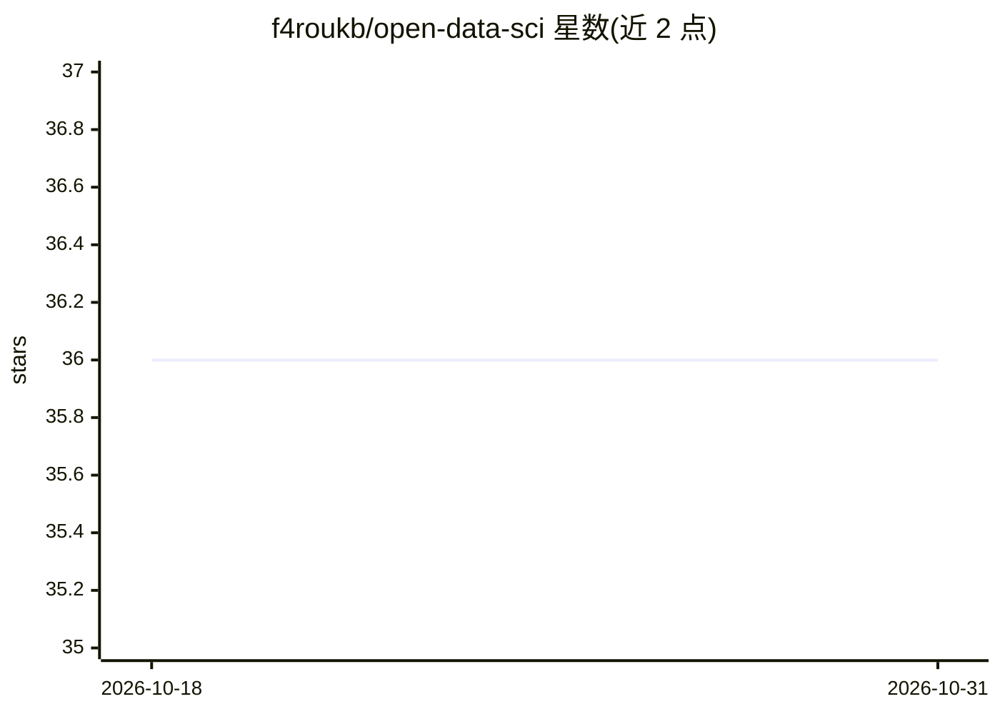

# f4roukb/open-data-sci

⭐ 36 · Python · Apache-2.0 · 推送 2026-10-24 · [GitHub](https://github.com/f4roukb/open-data-sci) · 个人维护

**自主完成数据科学与机器学习全流程的 AI agent，本地/云均可运行**

面向数据科学家的自主 AI agent：给定目标后自行规划、写代码、自我纠错并迭代，覆盖 EDA、清洗、特征工程、建模、评估、可视化与报告；洞察与数据画像跨会话持久累积。支持最多 3 个并行子代理、沙箱化 Python 执行、内置技能与自定义 Markdown 技能、Web 搜索与 MCP 连接。提供 TUI 终端界面与 Python SDK，支持主流云厂商与任意 OpenAI 兼容自托管服务器；出厂内置完整 ML 库栈（Polars/sklearn/LightGBM 等）。自报在 Kaggle Playground S6E5 以一次无指导运行进入前 30%。

## 筛选速览

| 维度 | 判定 | 备注 |
|---|---|---|
| AI 角色 | `ai-native` | 本体是模型或模型工具 |
| 许可风险 | `permissive` | Apache-2.0 |
| 部署形态 | `library` | 以包/库形式分发 |
| 模型依赖 | local-ok | 支持本地模型 |
| 硬件要求 | — | 无带数字的原话,不猜 |
| 安装摩擦 | `low` | 无编译、无系统依赖或容器化 |
| 成熟度 | — | 结构信号不足 |

## 能力要点

- 自主规划-执行-自纠错的完整数据科学工作流
- 跨会话的按项目知识累积（数据 schema、画像、笔记）
- 最多 3 个并行子代理的后台非阻塞代码执行
- 支持 Anthropic/OpenAI/Bedrock/Vertex/Azure/Ollama/vLLM 等提供方，可在单会话内混用模型

## 适用场景

- 让 agent 自主完成 Kaggle 类竞赛或 baseline 建模
- 作为首轮分析师探索数据并跑出基线，我再决定策略
- 通过技能文件注入领域知识并保持每次运行一致应用
- 在自有 OpenAI 兼容服务器上合规自托管运行

## 场景标签

`数据分析` · 领域:效率与自动化

## 证据(README 行号)

> L9: OpenDataSci is a secure AI agent specialized in data science and machine learning. It works autonomously: plans, cod
> L36: |**Full workflow**|EDA, cleaning, feature engineering, modelling, evaluation, visualisation, reporting|

## 星数曲线

2026-10-18 36 → 2026-10-31 36（+0）

---
*卡片 v1 · prompt 1.4 · 生成 2026-10-25 · 置信度 high · 依据 README sha `0e3efac22f57` · [字段定义](../../DATASET.md)*
